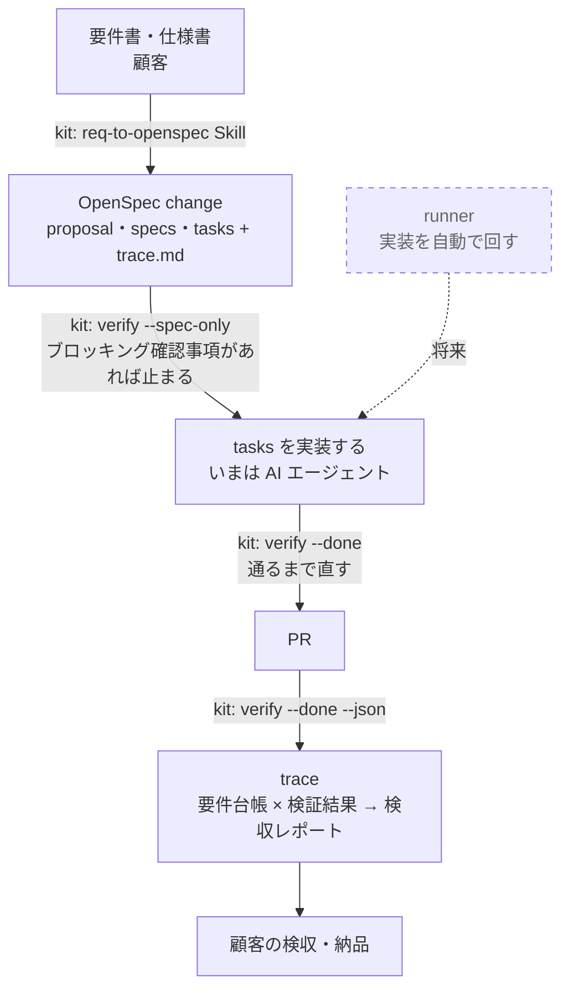
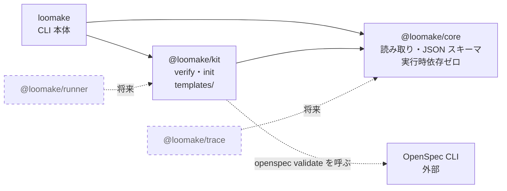

# Loomake アーキテクチャ

最終更新：2026-10-22

## 1. 一言でいうと

| 担当 | 役割 |
|---|---|
| OpenSpec（外部 OSS） | **何を作るか**：仕様の正 |
| `@loomake/kit` | **どう作らせ、どう確かめるか**：要件書の取り込み・共通ルール・検証ゲート |
| `@loomake/runner` | **作る**：仕様から PR まで実装を回す（AI エンジンは選べる） |
| `@loomake/trace` | **作ったと証明する**：合意・検収の証拠をまとめる |
| `@loomake/core` | 上の 3 つをつなぐ**契約**（trace.md・spec・verify 結果の読み書きと JSON スキーマ） |

仕様の書式は自作せず OpenSpec を使う。Loomake が担うのは、OpenSpec が持っていない「要件書からの入口」と「守らせる仕組み」と「検収の証拠」。

この表は将来の構成を含む。現在のリポジトリには core・kit・trace・CLI 本体（`loomake init`・`loomake verify`・`loomake trace`）があり、runner はまだない。使い方は [usage.md](usage.md) を参照。MVP の範囲は [要件定義書 v0.7](requirements/mvp-v0.7.md) を参照。

## 2. 流れ



点線はまだ作っていないもの（runner）。いまは、実装を AI エージェントに頼む。検収レポートは `loomake trace report` で作る。

## 3. 名前

ブランドは **Loomake ひとつ**に統一する（旧称：Loomkit → kit、Imploom → runner、Traspec → trace）。

| 種類 | 名前 |
|---|---|
| リポジトリ | `loomake/loomake`（モノレポ）、`loomake/site`（Docus） |
| npm | `@loomake/core` `@loomake/kit` `@loomake/trace` `@loomake/runner` |
| CLI | `loomake init` / `loomake verify` / `loomake trace` / `loomake run` |
| サイト | loomake.dev |

CLI は本体パッケージ `loomake`（`packages/cli`）を 1 つ作り、各サブコマンドを束ねる（setup-monorepo の Q-01 で決定）。いまあるのは `init`・`verify`・`trace` で、`run` はまだない。

## 4. リポジトリ構成

以下は将来の構成を含む。`packages/trace/` と `packages/runner/` はまだ作っていない。

いまのパッケージの依存関係は次のとおり。矢印は「依存する」向き。



`core`・`kit`・`loomake` の実行時依存はこの矢印の範囲に限る（REQ-046・REQ-047）。OpenSpec CLI は依存ではなく、別に入れたものを `verify` が呼び出す。

```
loomake/loomake            pnpm workspaces + changesets
├── .devcontainer/
├── packages/
│   ├── core/              @loomake/core
│   ├── kit/               @loomake/kit
│   ├── cli/               loomake（CLI 本体）
│   ├── trace/             @loomake/trace
│   └── runner/            @loomake/runner
└── openspec/              Loomake 自身の仕様（kit で自分を作る）
```

- **モノレポにする理由**：3 つのツールは契約（trace.md の書式・verify の JSON）でつながっており、初期は契約が頻繁に変わる。1 つの PR でまとめて直せるようにする。1 人開発なので分けるメリットがまだない
- npm は changesets でパッケージごとに別バージョンで出す
- **分けるタイミング**：外部コントリビューターが付いたとき、またはリリース周期が大きくずれたとき
- 既存の `traspec` は取り込まない。`packages/trace` は core の契約（trace.md・verify の JSON）の上に新しく作り、traspec は参考にとどめる（2026-10-22 決定）
- Nuxtart は Loomake とは別枠なので別リポジトリ
- 外部依存はなるべく減らす。特に `core` は依存ゼロを保つ

## 5. 作る順番

| 順 | 対象 | やること | 理由 | 状態 |
|---|---|---|---|---|
| 0 | core | `verify.mjs` の解析処理を切り出し、verify 結果の JSON スキーマに `schemaVersion` を付ける | 3 ツールすべてが依存するので最初に固める | 済み（add-core-parsers） |
| 1 | kit | `npx loomake init` で導入可能にし、実際の要件書を 1〜2 本流して直す | ここが甘いと後ろが全部ぶれる | 済み。init は add-init-cli。試験プロジェクトで kit-v1.0.md を流し、見つけた問題を 3 つの change で直した（2026-10-23） |
| 2 | trace | trace.md と verify JSON から検収レポートを出す | 実装が人手でも価値が出る。kit と合わせて「要件 → 実装 → 証拠」が一周する | 初版は済み（add-trace-record・add-trace-report、2026-10-23）。HTML の出力とリリース単位の集約は次のフェーズ |
| 3 | runner | Claude Code の headless 実行だけに対応し、1 つの change を PR まで持っていく MVP | 最も難しい。完了判定と証拠の出力先が先にあれば「verify が通るまで回す」に絞れる | 未着手 |

## 6. 開発環境

devcontainer を標準にする（Node 24・pnpm・OpenSpec CLI・Claude Code・Codex・gh）。

- ログイン情報（`~/.claude`・`~/.codex`）は名前付きボリュームに置く
- AI を権限確認なしで動かす場合はネットワークを許可ドメインに絞る。runner の実行環境はこの devcontainer を土台にする
