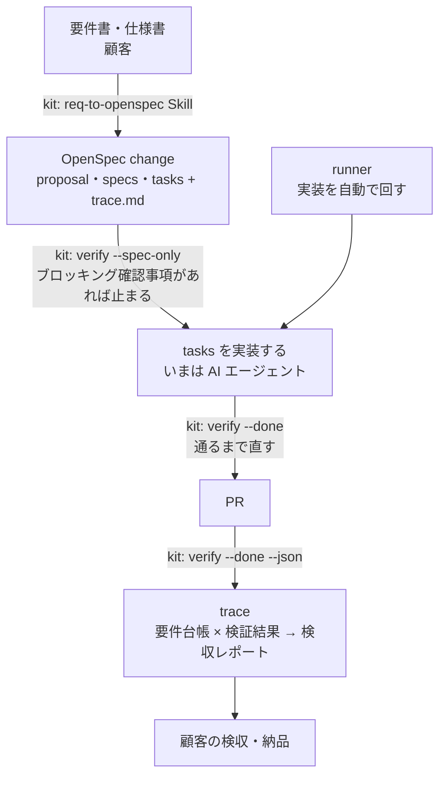
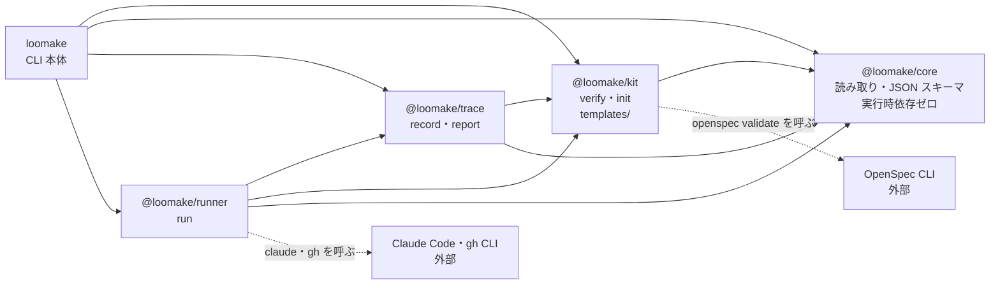

# Loomake アーキテクチャ

最終更新：2026-10-24

## 1. 一言でいうと

| 担当 | 役割 |
|---|---|
| OpenSpec（外部 OSS） | **何を作るか**：仕様の正 |
| `@loomake/kit` | **どう作らせ、どう確かめるか**：要件書の取り込み・共通ルール・検証ゲート |
| `@loomake/runner` | **作る**：仕様から PR まで実装を回す（AI エンジンは選べる） |
| `@loomake/trace` | **作ったと証明する**：合意・検収の証拠をまとめる |
| `@loomake/core` | 上の 3 つをつなぐ**契約**（trace.md・spec・verify 結果の読み書きと JSON スキーマ） |

仕様の書式は自作せず OpenSpec を使う。Loomake が担うのは、OpenSpec が持っていない「要件書からの入口」と「守らせる仕組み」と「検収の証拠」。

この表は将来の構成を含む。現在のリポジトリには core・kit・trace・runner・CLI 本体（`loomake init`・`loomake verify`・`loomake trace`・`loomake run`）がある。使い方は [usage.md](usage.md) を参照。MVP の範囲は [要件定義書 v0.7](requirements/mvp-v0.7.md) を参照。

## 2. 流れ



実装は `loomake run` で AI に任せるか、AI エージェントに直接頼む。検収レポートは `loomake trace report` で作る。

## 3. 名前

ブランドは **Loomake ひとつ**に統一する（旧称：Loomkit → kit、Imploom → runner、Traspec → trace）。

| 種類 | 名前 |
|---|---|
| リポジトリ | `loomake/loomake`（モノレポ）、`loomake/site`（Docus） |
| npm | `@loomake/core` `@loomake/kit` `@loomake/trace` `@loomake/runner` |
| CLI | `loomake init` / `loomake verify` / `loomake trace` / `loomake run` |
| サイト | loomake.dev |

CLI は本体パッケージ `loomake`（`packages/cli`）を 1 つ作り、各サブコマンドを束ねる（setup-monorepo の Q-01 で決定）。いまあるのは `init`・`verify`・`trace`・`run`。

## 4. リポジトリ構成

現在はcore・kit・trace・runner・CLIの5パッケージがある。

いまのパッケージの依存関係は次のとおり。矢印は「依存する」向き。



各パッケージの実行時依存はこの矢印の範囲に限る（REQ-046・REQ-047・REQ-083・REQ-123）。OpenSpec CLI・Claude Code・gh CLI は依存ではなく、別に入れたものを `verify` と `run` が呼び出す。

```
loomake/loomake            pnpm workspaces + changesets
├── .devcontainer/
├── packages/
│   ├── core/              @loomake/core
│   ├── kit/               @loomake/kit
│   ├── cli/               loomake（CLI 本体）
│   ├── trace/             @loomake/trace
│   └── runner/            @loomake/runner
└── openspec/              Loomake 自身の仕様（kit で自分を作る）
```

- **モノレポにする理由**：3 つのツールは契約（trace.md の書式・verify の JSON）でつながっており、初期は契約が頻繁に変わる。1 つの PR でまとめて直せるようにする。1 人開発なので分けるメリットがまだない
- npm は changesets でパッケージごとに別バージョンで出す
- **分けるタイミング**：外部コントリビューターが付いたとき、またはリリース周期が大きくずれたとき
- 既存の `traspec` は取り込まない。`packages/trace` は core の契約（trace.md・verify の JSON）の上に新しく作り、traspec は参考にとどめる（2026-10-22 決定）
- Nuxtart は Loomake とは別枠なので別リポジトリ
- 外部依存はなるべく減らす。特に `core` は依存ゼロを保つ

## 5. 作る順番

| 順 | 対象 | やること | 理由 | 状態 |
|---|---|---|---|---|
| 0 | core | `verify.mjs` の解析処理を切り出し、verify 結果の JSON スキーマに `schemaVersion` を付ける | 3 ツールすべてが依存するので最初に固める | 済み（add-core-parsers） |
| 1 | kit | `npx loomake init` で導入可能にし、実際の要件書を 1〜2 本流して直す | ここが甘いと後ろが全部ぶれる | 済み。init は add-init-cli。試験プロジェクトで kit-v1.0.md を流し、見つけた問題を 3 つの change で直した（2026-10-23） |
| 2 | trace | trace.md と verify JSON から検収レポートを出す | 実装が人手でも価値が出る。kit と合わせて「要件 → 実装 → 証拠」が一周する | 初版は済み（add-trace-record・add-trace-report、2026-10-23）。HTML の出力とリリース単位の集約は次のフェーズ |
| 3 | runner | Claude Code の headless 実行だけに対応し、1 つの change を PR まで持っていく MVP | 最も難しい。完了判定と証拠の出力先が先にあれば「verify が通るまで回す」に絞れる | 初版は済み（add-run-loop・add-run-guards・add-run-pr、2026-10-23）。`--resume`、Codex、エンジンの共通のインターフェースは次のフェーズ |

## 6. 開発環境

devcontainer を標準にする（Node 24・pnpm・OpenSpec CLI・Claude Code・Codex・gh）。

- ログイン情報（`~/.claude`・`~/.codex`）は名前付きボリュームに置く
- AI を権限確認なしで動かす場合はネットワークを許可ドメインに絞る。runner の実行環境はこの devcontainer を土台にする


## 7. ドメインのルールとI/Oの境界

Loomakeでは、要件と合意、検証、証拠と検収、自動実装を分けて考える。パッケージの境界と業務の責務は次のように対応する。

| 責務 | 正とする情報 | ルールとI/Oの担当 |
|---|---|---|
| 要件と合意 | レビューしたchangeのtrace.mdと差分仕様 | coreが解析とモデル化を行い、kitがファイルを読む |
| 検証 | 合意のモデル、差分仕様、実行した品質コマンドとテスト結果 | coreが合意とテスト対応を判定し、kitが実行と表示を行う |
| 証拠と検収 | 検証結果と、その時点の文書とコミット | traceが整合性を検証し、記録とレポートのI/Oを行う |
| 自動実装 | tasks.md、Gitの状態、検証結果 | runnerがエンジン・Git・検証・証拠記録を順に実行する |

Requirementは差分仕様の振る舞いを記述する単位で、REQ-IDは要件台帳の要件を識別する。両者はSource行で対応し、同じものとして扱わない。成功したテストの名前にあるREQ-IDは対応の存在を示し、テストの十分さは別にレビューする。

Markdownの列名をキーにするTraceは入出力用の型として維持する。createAgreementはそこからAgreementを作り、要件IDを検証済みのRequirementId、状態を4値のLedgerState、ブロッキング値をbooleanとして扱う。不正な行はParseResultのerrorsへ残す。呼び出し側はerrorsを確認し、不正な入力を合格扱いにしない。

evaluateAgreementは、未回答のブロッキング質問、確認待ち、未承認の仮定、出典不足を判定する。evaluateTestCoverageは、必要な要件と成功したテストの対応と不足を判定する。どちらもファイル・環境・時計を読まない。パスの正規化、日本語の表示、コマンド実行はkitが担当する。

coreは共有する契約とルールに範囲を絞り、実行時依存ゼロを保つ。runnerの設定検証とtraceの証拠検証も、それぞれの責務の中でI/Oから分離する。

自動実装の次の段階は、runnerの内部モデルで判断する。EngineObservationとGateObservationは観測済みの読み取り専用の値で、判断する関数はファイル・時計・環境を読まない。phases.tsが観測と副作用を担当する。

| 観測後の判断 | モデルが返す結果 | 呼び出し側が行う処理 |
|---|---|---|
| decideAfterEngine | 続行、停止、中断と理由 | 停止ならタスクを完了にせず記録する。続行なら変更の検査とコミットへ進む |
| decideAfterGate | 合格、再修正、停止と理由 | 合格ならゲートのタスクを完了にし、再修正ならエンジンを呼ぶ |

エンジン後は中断・出力上限・時間上限・質問・終了コードの順に判断する。HEADの変更やGit内部の変更は理由を先に示し、中断の状態は保つ。ゲート後は検証中の状態変更・合格・期限・修正回数の順に判断する。Gitの観測、記録、タスク更新とコミットをモデルへ持ち込まず、副作用の順序は統合試験でも確認する。公開APIとスキーマは維持する。

直接試験は優先順位の重なりと修正回数の境界を含む。コピーで3条件を壊して同じ試験を実行し、構文や読み込みのエラーを誤りの検出に数えず、assertionの失敗を確認する。これは選んだ規則の検出結果であり、全コードのmutation scoreではない。


## 8. 入力予算とエラーの境界

文書・JSON・探索のI/Oは、kitのcreateInputReaderへ集約する。coreは引き続き解析とドメインの判定を担当し、ファイルの読み取り予算を持ち込まない。verifyは同じ文書処理のreaderを共有し、traceは文書スナップショットと証拠JSON、runnerは指示に読む文書とタスク・証拠の再利用へ使う。

文書とJSONの予算は別に定義し、readerが実際の読み取り量と訪問項目を数える。trace reportは全証拠を同時に保持せず、検証しながら最新だけを残す。runnerは文書の読み取り量に加え、検証の失敗情報も含めた指示全体のバイト数を送信前に確認する。

UsageErrorはkitの共通モジュールに置き、configからの従来のexportを維持する。設定とreaderが相互にimportする依存を避ける。上限の数値と互換性への影響、測定の範囲は[resources.md](resources.md)を参照する。これらはOSの隔離やプロセス全体のRSS制限ではない。


## 9. 同期外部操作と共有期限

kitのrunExternalが、Git・gh・OpenSpec検証と期限つきの品質コマンドの監視を担当する。runnerとtraceはコマンドの意味と結果を解釈し、プロセスグループ・時間・出力の監視を重複させない。runはwithProcessBudgetで残り時間を処理の範囲へ伝え、準備と証拠・PRまで同じ予算を使う。

共有期限と中断状態はAsyncLocalStorageに置き、別の非同期実行へ漏らさない。ネストでは外側の期限を延ばさない。通常の非ゼロ終了は各呼び出し側が解釈し、制限停止はUsageErrorの派生型で区別する。coreにプロセスや時計を持ち込まず、実行時依存の方向も維持する。

期限を使う操作の範囲と、単独verifyの品質コマンドの例外は[resources.md](resources.md)を参照する。共有期限はOSの隔離や、ファイルI/Oを含むすべての処理を中断する仕組みではない。
