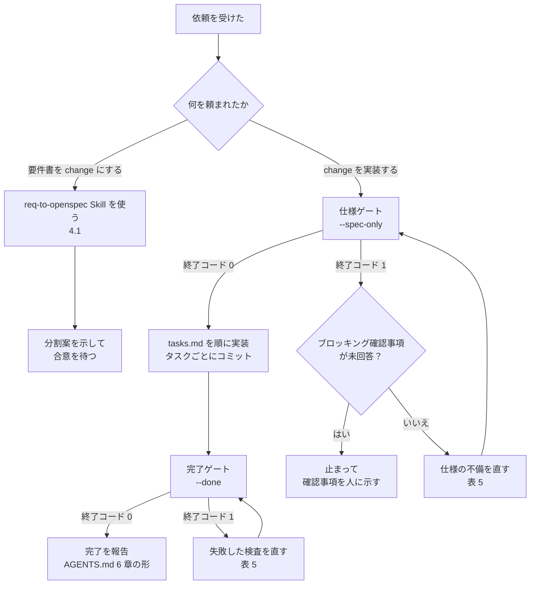

# AI エージェント向けの使い方

Loomake を入れたプロジェクトで作業する AI エージェント（Claude Code・Codex など）向けの手順。人向けの説明は [usage.md](usage.md) にある。

決まりの正本はプロジェクトの `AGENTS.md` で、この文書と食い違うときは `AGENTS.md` に従う。この文書は、決まりを守りながら Loomake のコマンドをどう使うかを、状況ごとに引けるようにまとめたもの。

## 1. 最初に確かめること

作業を始める前に、次を確かめる。

| 確かめること | 方法 | 無いとき |
|---|---|---|
| Loomake が入っている | `AGENTS.md` と `loomake.config.json` がある | 人に `npx loomake init` を頼む。自分では実行しない（既存ファイルの上書きを人が判断するため） |
| OpenSpec が初期化されている | `openspec/` がある | 人に `openspec init` を頼む |
| どの change の作業か | 人の依頼、ブランチ名、`openspec/changes/` の一覧 | 人に聞く |
| verify の実行方法 | `AGENTS.md` の「作業の流れ」に書かれたコマンド | `npx loomake verify` を使う |

以降のコマンドは `npx loomake verify` と書く。`AGENTS.md` に別の書き方（例：`pnpm -s verify`）があれば、そちらに読み替える。

## 2. 状況ごとの手順



| 状況 | すること | してはいけないこと |
|---|---|---|
| 要件書を渡され、change にするよう頼まれた | req-to-openspec Skill の手順に従う（[3 章](#3-要件書を-change-にする)） | 分割案に人が合意する前に、change を書き出す |
| change の実装を頼まれた | まず仕様ゲートを通す（[4 章](#4-change-を実装する)） | 仕様ゲートが不合格のまま実装に入る |
| 仕様に無い振る舞いが必要になった | 実装を止め、change の specs を直す提案をする | 推測で実装する |
| 曖昧な要件に気づいた | `trace.md` の確認事項に書いて止まる | 仮定で埋めて先へ進む |
| テストが通らない | 実装を直す | テストを弱める・skip する・期待値を実装に合わせる |
| 設定を変えたくなった | 人の承認を取る | `loomake.config.json` や lint・型・テストの設定を、承認なしに緩める |
| change がマージされた | 人に頼まれたら `openspec archive <change-id>` を実行する | `openspec/specs/` を直接編集する（新しい capability の Purpose の仮の文を書き換えるときだけは例外） |

## 3. 要件書を change にする

1. 要件書が Markdown（.md）か確かめる。Word・Excel・PDF なら読まずに、Markdown に変換して渡すよう人に頼んで止まる
2. req-to-openspec Skill の手順に従う。要件台帳、確認事項・仮定、分割案の順に進める
3. 分割案を人に示し、合意を待つ
4. 合意を得たら change を書き出し、次の 2 つを実行する

   ```sh
   openspec validate <change-id> --strict
   npx loomake verify --change <change-id> --spec-only
   ```

5. 報告する。ブロッキング確認事項が未回答で仕様ゲートが不合格なのは、正常な結果。直さずに、確認事項を人に示す

## 4. change を実装する

1. 仕様ゲートを通す

   ```sh
   npx loomake verify --change <change-id> --spec-only
   ```

2. `tasks.md` の順に実装する。1 タスクごとにコミットし、終わったタスクは `- [x]` にする
3. 各 Requirement にテストを書く。テスト名か `describe` の名前に要件 ID を入れる

   ```ts
   it('[REQ-012] 未ログインのとき 401 を返す', () => { /* ... */ });
   it('[REQ-012][REQ-013] 期限切れのセッションは破棄して 401 を返す', () => { /* ... */ });
   ```

   要件 ID は `specs/<capability>/spec.md` の各 Requirement にある `Source: REQ-xxx` 行で分かる

4. 完了ゲートを通す

   ```sh
   npx loomake verify --change <change-id> --done
   ```

5. 合格したら、`AGENTS.md` の「報告の形」で報告する

## 5. verify が不合格のときの直し方

出力の `✖` の行が不合格の検査。行の下に字下げされた詳細が出る。`--json` を付けると、`results[]` の `check` と `detail` で同じものが読める。

| 検査（`check`） | 詳細の例 | 直し方 |
|---|---|---|
| `change の存在` | `openspec/changes/x がありません` | change-id が正しいか確かめる |
| `proposal.md の存在` など | `tasks.md がありません` | change のファイルを作る |
| `openspec validate` | OpenSpec の出力 | 出力に沿って proposal・specs を直す |
| `要件台帳` | `「## 要件台帳」の表がありません` | trace.md の見出しと表を、テンプレートの形に戻す |
| `台帳の状態値` | `REQ-003: "保留"` | 状態を `反映済`・`確認待ち`・`範囲外`・`既存仕様で充足` のどれかにする |
| `台帳の出典` | `出典が空：REQ-004` | 要件書の文書名・章と行を書く |
| `ブロッキング確認事項` | `Q-01（REQ-002）…` | **自分では答えない。** 止まって、確認事項を人に示す |
| `差分仕様` | `specs/<capability>/spec.md がありません` | 差分仕様を書く |
| `Requirement の Source` | `specs/auth/spec.md: ログイン` | その Requirement の本文の直後に `Source: REQ-xxx` 行を足す |
| `Source が台帳にある` | 台帳に無い要件 ID | 台帳に載せるか、Source の ID を直す。出典の無い要件は作らない |
| `Scenario の有無` | Requirement の名前 | `#### Scenario:` を 1 つ以上書く |
| `反映済の要件が仕様にある` | `REQ-007` | 台帳で `反映済` なのに、どの Requirement も参照していない。Requirement を書くか、状態を直す |
| `確認待ちが残っていない` | `REQ-002` | 確認事項の回答を待つ。回答が出たら仕様に反映し、状態を `反映済` にする |
| `tasks.md` | `- [ ] 1.2 …` | 残りのタスクを実装し、チェックする |
| `command: lint` など | コマンドの出力の末尾 | 出力に沿って直す。設定を緩めて通さない |
| `要件ごとのテスト` | `テストが無い要件：REQ-012` | 名前に `[REQ-012]` を含むテストを書き、成功させる。skip したテストと失敗したテストは数えない |
| `要件ごとのテスト` | `テストのレポート（…）がありません` | テストランナーが JSON レポートを書き出していない。設定を変える前に人に確かめる |

警告（`!`）は不合格ではない。`仮定の承認`（未承認の仮定）と `確認待ちの要件` は、報告に含めて人に知らせる。

## 6. 終了コードと JSON

| 終了コード | 意味 | 次の行動 |
|---|---|---|
| 0 | すべて合格か警告 | 先へ進む。警告は報告に含める |
| 1 | 1 つ以上の検査が不合格 | [5 章](#5-verify-が不合格のときの直し方)の表で直す |
| 2 | 使い方か `loomake.config.json` の誤り | 標準エラーの使い方を読んで、コマンドを直す。設定の誤りなら人に知らせる |

機械的に判定するときは `--json` を付ける。標準出力は JSON だけになり、進捗は標準エラーに出る。

```sh
npx loomake verify --change <change-id> --done --json > verify.json
```

| フィールド | 使い方 |
|---|---|
| `ok` | `true` なら合格 |
| `results[].status` | `fail` の項目を直す。`warn` は報告する |
| `results[].check`・`detail` | [5 章](#5-verify-が不合格のときの直し方)の表を引く |
| `coverage` | 要件 ID → テストファイルの一覧（完了ゲートのみ）。空の配列の ID は、テストが無い要件 |

形は `@loomake/core` の `verify-result.schema.json`（`schemaVersion` 1.0.0）で決まっている。

## 7. 人への依頼文の例

人がエージェントに頼むときは、次のように書くと伝わりやすい。

```
req-to-openspec スキルで docs/requirements/order-v1.0.md を change にして
```

```
openspec/changes/add-order-export の tasks.md を順に実装して。AGENTS.md に従って、タスクごとにコミット。
```

```
npx loomake verify --change add-order-export --done を通して。落ちた検査は、出力の詳細に沿って直して。テストと設定は緩めないで。
```

この文書は Loomake のリポジトリにあり、`loomake init` は利用者のプロジェクトに置かない。エージェントに読ませるときは、この文書の URL を渡す。
