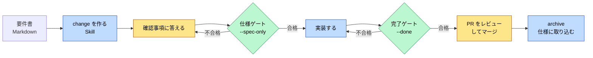
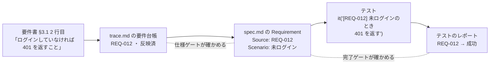
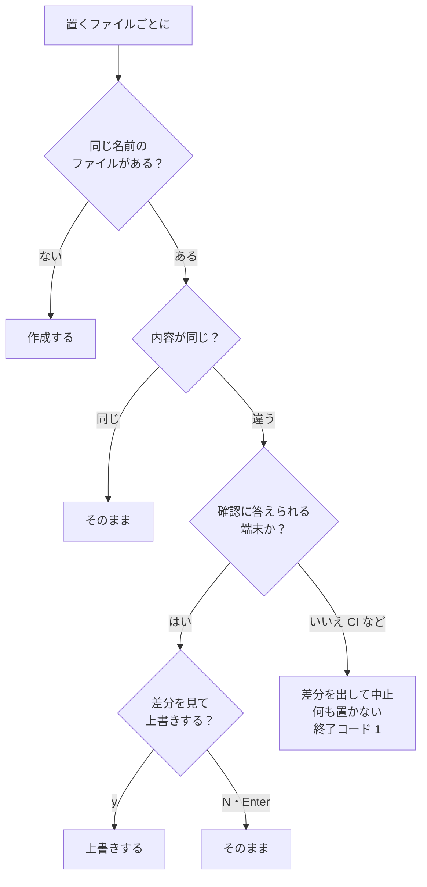
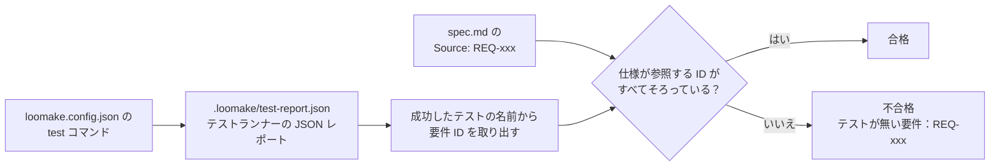
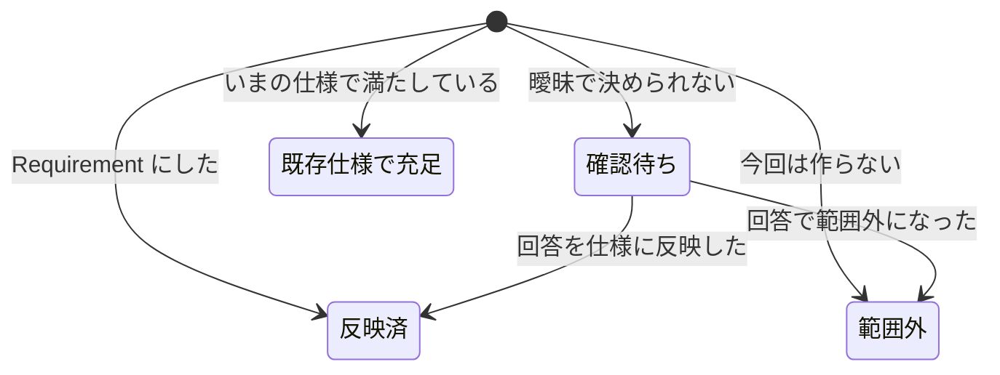

Loomake を自分のプロジェクトに入れて、要件書から AI に実装させるまでの手順をまとめる。1 ページの要約は [quickstart.md](1.quickstart.md) にある。AI エージェントに読ませる手順は [for-agents.md](../2.guides/1.for-agents.md)、このリポジトリ自身を開発する手順は [flow.md](https://github.com/loomake/loomake/blob/main/docs/flow.md) にある。

## 1. Loomake がすること

AI に要件書を渡して実装させると、曖昧な点が推測で埋められ、どの要件をどのテストで確かめたかも追えなくなる。Loomake は [OpenSpec](https://github.com/Fission-AI/OpenSpec) の上で、次の 3 つを受け持つ。

| 道具 | 役割 |
|---|---|
| req-to-openspec Skill | 要件書を、出典つきの OpenSpec change（proposal・specs・tasks・trace）に変える |
| AGENTS.md | AI が従う共通ルール（仕様の正、作業の流れ、完了の定義、禁止事項、報告の形） |
| `loomake verify` | 仕様ゲート（実装に入ってよいか）と完了ゲート（要件ごとにテストがあるか）を機械的に確かめる |

1 つの change は次の順に進む。人がするのは、確認事項への回答と PR のレビューが中心になる。



黄色は人、青は AI エージェント、緑は `loomake verify` が受け持つ。

### 要件からテストまでのつながり

Loomake の検査は、要件書の 1 文に振った要件 ID（`REQ-012` など）を手がかりにする。同じ ID が台帳・仕様・テストの名前に入るので、どの要件をどのテストで確かめたかを機械的にたどれる。



- 仕様ゲートは、台帳の ID と Requirement の `Source:` が対応しているか、未回答のブロッキング確認事項が無いかを確かめる
- 完了ゲートは、仕様が参照するすべての ID に、名前にその ID を含む成功したテストがあるかを確かめる

## 2. 必要なもの

- Node.js 22.12 以上
- [OpenSpec CLI](https://github.com/Fission-AI/OpenSpec)（`npm install -g @fission-ai/openspec`）
- Skill を読める AI エージェント（Claude Code または Codex）
- 要件書は Markdown（.md）で用意する。Word・Excel・PDF の要件書は、先に Markdown に変換しておく。Skill は Markdown 以外の要件書を読まずに、変換を求める

## 3. 導入する

プロジェクトのルートで実行する。

```sh
npx loomake init
```

> `loomake` はまだ npm に公開していない。公開するまでは、このリポジトリで `pnpm build` したあと、`node <このリポジトリ>/packages/cli/dist/cli.js init` で同じことができる。

次のファイルが置かれる。

| ファイル | 中身 |
|---|---|
| `AGENTS.md` | AI が従う共通ルール。末尾の「プロジェクト固有の情報」は自分のプロジェクトに合わせて書き換える |
| `CLAUDE.md` | `@AGENTS.md` だけ。Claude Code に AGENTS.md を読ませる |
| `loomake.config.json` | verify の設定（[6 章](#usage-config)） |
| `.claude/skills/req-to-openspec/` | req-to-openspec Skill |

```
あなたのプロジェクト/
├── AGENTS.md                         AI が従う共通ルール
├── CLAUDE.md                         @AGENTS.md（Claude Code 用）
├── loomake.config.json               verify の設定
├── .claude/skills/req-to-openspec/   Skill（Claude Code 用）
│   ├── SKILL.md
│   ├── references/                   曖昧さのチェックリスト、OpenSpec の書式
│   └── templates/trace.md            trace.md の雛形
├── .agents/skills/req-to-openspec/   --codex のとき。中身は上と同じ
└── .devcontainer/devcontainer.json   --devcontainer のとき
```

次のオプションがある。

| オプション | すること |
|---|---|
| `--codex` | Skill を `.agents/skills/req-to-openspec/` にも置く（Codex 用） |
| `--devcontainer` | `.devcontainer/devcontainer.json`（Node 24・Claude Code・OpenSpec CLI）を置く |

`loomake.config.json` の品質コマンドは package.json の `packageManager`（なければロックファイル）から pnpm・npm・yarn を判定して決まる。どれも分からなければ npm になる。
package.json がないときは npm の既定値で書かれ、init の最後に、このプロジェクトのコマンドへ書き換えるよう案内が出る。

最後に、loomake をプロジェクトの開発用の依存に足す。AGENTS.md と Skill が使う `npx loomake verify` は、プロジェクトに入れた版を使う。入れていないと実行のたびに最新版を取りにいき、検査に使う版が固まらない。package.json の依存に loomake がなければ、init の最後に同じ案内が出る。

```sh
pnpm add -D loomake      # npm なら npm install -D loomake、yarn なら yarn add -D loomake
```

### 既にファイルがあるとき



- 同じ名前で内容の違うファイルがあると、差分を表示して「上書きしますか [y/N]」と聞く。Enter だけなら上書きしない
- 内容が同じファイルは、聞かずにそのままにする（改行コードだけの違いは同じとみなす）
- CI やパイプなど、確認に答えられない環境で内容の違うファイルがあると、差分を表示し、何も置かずに終了コード 1 で止まる。端末から実行し直す

テンプレートが新しくなったときも、`loomake init` をもう一度実行すれば差分を見ながら更新できる。

### 導入のあとにすること

1. `openspec/` が無ければ `openspec init` を実行する（init が案内する）
2. テストランナーが結果を JSON で `.loomake/test-report.json` に書き出すよう設定する。verify はこのファイルで、要件ごとのテストを確かめる。init は、依存に vitest か jest があれば、そのテストランナーの設定例だけを表示する

   Vitest では `vitest.config.ts` に書く。

   ```ts
   export default defineConfig({
     test: { reporters: ['default', 'json'], outputFile: { json: '.loomake/test-report.json' } },
   });
   ```

   Jest では package.json の test スクリプトに書く。

   ```sh
   jest --json --outputFile=.loomake/test-report.json
   ```

3. `loomake.config.json` の `commands` を確かめる。package.json に `scripts` があるとき、init は lint・typecheck・test のうち実在する script のコマンドだけを書き、書かなかった名前を案内する。script を足したら、commands にも書く
4. `.gitignore` を確かめる。`loomake init` は、テストのレポート（`.loomake/test-report.json`）の行を足す。証拠の記録（`.loomake/evidence/`）はコミットするので、`.loomake/` を丸ごと除外しない
5. `AGENTS.md` の末尾の「プロジェクト固有の情報」を書き換える
6. `npx loomake doctor` で、導入が済んでいるかを確かめる。設定ファイル、OpenSpec、品質コマンドの実行ファイル、`.gitignore` の除外、使う CLI（openspec・claude・gh）を調べ、問題があれば直し方を表示する。doctor はファイルを変えず、品質コマンドも実行しない。問題が 1 つでもあれば終了コードは 1。単純なnpm・pnpmのscriptの存在と実行権限も確認する。未対応の構文、Yarnの解決先、レポート生成・認証などの未確認の範囲と復旧方法は[doctor.md](../2.guides/2.doctor.md)を参照する

`npx loomake --help` でコマンドの一覧を、`npx loomake <コマンド> --help` でそれぞれの使い方を表示する。

## 4. 1 つの change を進める

### 4.1 要件書を change にする

要件書を版を含む名前でリポジトリに置き（例：`docs/requirements/order-v1.0.md`）、AI エージェントに頼む。

```
req-to-openspec スキルで docs/requirements/order-v1.0.md を change にして
```

Skill は次の順に進める。

1. 要求を述べている文を 1 文ずつ `REQ-001` から採番し、出典（文書名・章と行）つきで要件台帳に載せる
2. 曖昧さのチェックリストを全要件にあて、確認事項（Q）か仮定（A）として記録する。お金・個人情報・権限・データ削除・外部連携・受け入れの数値に関わる曖昧さは、仮定にせず、必ずブロッキングな確認事項にする
3. change の分割案（リリースの単位）を示す。**人が合意するまで書き出さない**
4. `openspec/changes/<change-id>/` に proposal.md・specs・tasks.md・trace.md を書く
5. change 一覧、台帳の集計、ブロッキング確認事項、未承認の仮定を報告する。ブロッキング確認事項は要件を出した人にそのまま送れる文面で出る

### 4.2 確認事項に答え、仕様ゲートを通す

`trace.md` を開き、確認事項の「回答」欄と、仮定の「承認」欄を埋める。要件を出した人に聞くものは、Skill が出した文面を送って回答をもらう。

```sh
npx loomake verify --change <change-id> --spec-only
```

| 結果 | 意味 |
|---|---|
| 合格（終了コード 0） | 実装に入ってよい。未承認の仮定と確認待ちの要件は警告として出るが、止まらない |
| 不合格（終了コード 1） | 未回答のブロッキング確認事項や、仕様の不備がある。詳細に沿って直し、もう一度実行する |

回答で仕様が変わるときは、AI に頼んで spec.md と tasks.md にも反映させる。

### 4.3 実装する

change-id と同じ名前のブランチを切り、AI に頼む。

```
openspec/changes/<change-id> の tasks.md を順に実装して。AGENTS.md に従って、タスクごとにコミット。
```

AGENTS.md の決まりにより、AI は次のように動く。

- 仕様に無い振る舞いが必要になると、止まって質問する。答えるか、仕様を直すかを選ぶ
- テストを弱める、skip する、設定を緩めるといった変更は、人の承認なしにはしない
- テスト名に要件 ID を入れる：`it('[REQ-012] 未ログインのとき 401 を返す', ...)`。1 つのテストで複数の要件を確かめるときは `[REQ-012][REQ-013]` と並べる。`describe` の名前に入れてもよい

### 4.4 完了ゲートを通して PR を出す

```sh
npx loomake verify --change <change-id> --done
```

仕様ゲートの検査に加えて、次を確かめる。

- tasks.md のタスクがすべてチェック済み
- 確認待ちの要件が残っていない
- `loomake.config.json` の品質コマンド（lint・typecheck・test）がすべて成功する
- 仕様で参照されている要件 ID ごとに、名前にその ID を含むテストが 1 つ以上あり、実際に成功している。skip したテストや、実行されなかったテストは数えない

要件ごとのテストは次のように判定する。



テストのファイルの中身ではなく実行結果で判定するので、skip したテストや失敗したテスト、テストランナーが実行しなかったファイルのテストは数えない。

合格したら PR を出す。

### 4.5 マージしたら archive する

```sh
openspec archive <change-id>
git add -A openspec
git commit -m "archive: <change-id>"
```

差分仕様が `openspec/specs/`（いまの仕様）に取り込まれ、change は `openspec/changes/archive/` に移る。新しい capability ができたときは、`openspec/specs/<capability>/spec.md` の `## Purpose` が仮の文（`TBD - …`）になるので書き換える。それ以外で `openspec/specs/` を直接編集してはいけない。

### 4.6 リリースレポートを作る

完了ゲートを通したコミットで `loomake trace record` を実行し、verify の結果を証拠として残す。そのあと `loomake trace report` で、要件ごとの検査結果をまとめたリリースレポートを作る。

```sh
npx loomake trace record --change <change-id>
git add .loomake/evidence && git commit -m "evidence: <change-id>"
npx loomake trace report --change <change-id> > report.md
```

- `trace record` は `verify --done` を実行し、結果を検査したコミットの SHA・日時と合わせて `.loomake/evidence/<change-id>/` に新しいファイルとして保存する。検証した時点の trace.md と差分仕様の内容・パス・SHA-256 も一緒に保存する。不合格の結果も記録する。終了コードは verify と同じ
- 検査のあいだに HEAD・作業ツリー・trace.md や差分仕様が変わったら、どの内容を検査したか分からないので記録しない。`.gitignore` で除外したテストのレポートの書き出しは、変更とみなさない
- 作業ツリーに未コミットの変更（追跡していないファイルを含む）があると、記録しない。記録したファイルは、そのままコミットする。`.gitignore` で `.loomake/` を除外しているなら、`.loomake/evidence/` だけは除外から外す
- `trace report` は、いちばん新しい記録に保存した trace.md・差分仕様と検査結果から、要件ごとの出典・Requirement・テスト・検査結果の表、確認事項と仮定の一覧を出す。記録のあとで文書を書き換えても、表は記録したときの内容のまま。archive したあとの change にも使える
- 冒頭に、合格したテストのない要件、確認待ちの要件、記録のあとで変わった文書を挙げる。回答や承認があるのに回答者・回答日・承認者・承認日が空の行は、末尾で警告する
- 文書を保存していない古い形式の記録では、いまの文書から表を作り、合格を「合格（仕様との対応は未確認）」と表示する
- レポートには、自動検査が確かめた範囲を書く。確かめるのは、要件 ID を名前に含む成功したテストがあることまで。テストの中身が要件を満たしているかは、人がレビューで判断する
- `--format json` で JSON を出す。省くと Markdown になる。HTML はまだ出せない
- 同じ入力からは、毎回同じレポートになる（作った日時は入れない）

### 4.7 実装から PR までを AI に任せる

`loomake run` は、仕様ゲートを通った change のタスクを Claude Code に 1 つずつ実装させ、完了ゲートが通るまで直させてから、証拠を記録して PR を出す。devcontainer の中で、未コミットの変更がない状態で実行する。`claude` と `gh` のコマンドが要る。

```sh
npx loomake run --change <change-id> --dry-run   # 渡すタスクと指示を確かめる
npx loomake run --change <change-id>
```

- `loomake/<change-id>` のブランチで、タスクを終えるたびに `run(<change-id>): …` でコミットする。tasks.md の完了は run が付ける。完了ゲートを通すタスクはエンジンに渡さず、合格したときに完了にする
- 完了ゲートのタスクは、行末の `<!-- loomake:gate=done -->` の印で見分ける。印がなくても、本文に `verify` と `--done` を含むタスクは完了ゲートのタスクとみなすが、印を付けるよう案内が出る
- エンジンには、git でコミットしたりブランチを切り替えたりしないよう指示する。それでもエンジンが自分でコミットするかブランチを切り替えたら、そのタスクを完了にせずに止まり、前後の SHA とブランチ名、その間の差分、確かめる手順と戻す手順を表示する。run はエンジンのコミットを取り消さない
- 止まったあとは、どのブランチからもう一度実行しても、`loomake/<change-id>` に切り替えてから、そのブランチの tasks.md の続きを渡す。エンジンが 0 以外の終了コードで終わったときも、そのタスクを完了にせずに止まる
- 完了ゲートに不合格なら、内容をエンジンに渡して直させる。直しの回数（既定 5 回）か実行時間（既定 60 分）が上限に達したら止まる。上限は loomake.config.json の `run.maxFixes`・`run.timeoutMinutes` で変えられる
- エンジンが変更を残さず、変更不要の合図と理由も出さずに終わると、タスクを完了にせず止まる。変更が要らないタスクは、行頭の `LOOMAKE-NOCHANGE:` に続けて同じ行に空でない理由を書いたときだけ、tasks.md だけのコミットで完了にする。質問もあれば質問で止まる
- 変更不要の理由は、既知形式の秘密情報を置換したあと、端末の制御文字を `\u001b` のような文字列に変え、末尾の空白を含めて標準出力とコミット本文に同じ文字列を残す。出力の記録は、秘密情報を置換したうえで制御文字の原文を保つ
- 完了ゲートの直しで差分がないときは、変更不要の合図があっても上限を待たず再検証せずに止まり、完了ゲートのタスクを未完了のまま残す。停止理由に表示される出力記録の具体パスで、エンジンの出力を確認する
- エンジンが仕様にない判断に迷ったら、`LOOMAKE-QUESTION:` の行で質問して止まる。確認事項に答えてから、もう一度実行する
- テストの削除や skip、すでにあるアサーションとテストの書き換え・削除、lint・型・テストの設定、いまの仕様、trace.md の変更を見つけたら、変更をコミットせずに残して止まる。承認するなら、差分を確かめ、tasks.md のそのタスクを完了にして自分でコミットし、もう一度実行する
- 合格したら `loomake trace record` で証拠を記録してコミットし、ブランチを送って `gh pr create` で PR を作る。PR の向き先は、run が `loomake/<change-id>` を作ったときのブランチで、git の設定 `branch.loomake/<change-id>.loomake-base` に覚えておく。マージは人がする
- 止まったときは、理由・終えたタスク・残ったタスク・最後の検査結果を表示する。実行の記録は `.loomake/runs/` にあり、git では追跡しない
- 始めたあとに git の操作か証拠の記録が失敗したときも、理由を実行の記録に書いて終了コード 1 で止まる。始める前の git の失敗（git のリポジトリでないなど）は、使い方の誤りとして終了コード 2 になる。始める前に外部操作が時間・出力の上限か中断で止まったときは、実行時の失敗として終了コード 3 になる
- ふだんはファイルの読み書きと loomake.config.json の commands だけを Claude Code に許可する。権限確認なしで動かすのは、通信を npm・GitHub・エンジンの API に絞った環境で `LOOMAKE_SANDBOX=1` を設定し、`--skip-permissions` を付けたときだけ

### 確認事項の回答と仮定の承認を書く

trace.md の表を直接編集する代わりに、コマンドで書ける。回答・承認と一緒に、回答者・承認者と日付（省くとその日）も書く。すでに回答や承認がある行は上書きしない。直すときは trace.md を編集する。

```sh
npx loomake trace answer --change <id> --question Q-01 --answer "5 回" --by 担当者
npx loomake trace approve --change <id> --assumption A-01 --by PM
```

## 5. `loomake verify` のリファレンス

```
loomake verify [--change <id> (--spec-only | --done)] [--json] [--skip-commands]
```

| オプション | 意味 |
|---|---|
| `--change <id> --spec-only` | 仕様ゲート |
| `--change <id> --done` | 完了ゲート |
| （`--change` なし） | 品質コマンドだけを実行する |
| `--json` | 結果を JSON で標準出力に出す。進捗は標準エラーに出る |
| `--skip-commands` | 品質コマンドを実行しない。前に書き出したテストのレポートで判定する。結果には状態 `skip` の「品質コマンド」の項目が入り、最後の行に「品質コマンドを実行していません」と出る。完了の確認には使わない |

値をとるオプションは、`--change <id>` と `--change=<id>` のどちらでも書ける。知らないオプションには、近い候補（「もしかして：--change」）を示す。

終了コードは、すべて合格か警告なら 0、1 つでも不合格なら 1、使い方や設定の誤りなら 2、外部操作（OpenSpec CLI・git など）が時間・出力の上限か中断で止まったときは 3。

### 検査の一覧

| 検査 | 仕様ゲート | 完了ゲート |
|---|---|---|
| change・proposal.md・tasks.md・trace.md の存在 | ✓ | ✓ |
| `openspec validate --strict` | ✓ | ✓ |
| 要件台帳（台帳の出典、状態値） | ✓ | ✓ |
| ブロッキング確認事項に回答がある | ✓ | ✓ |
| 同じ確認事項の回答が、参照先の change と同じ（質問に「<change-id> の Q-xx と同じ質問」とあるもの） | ✓ | ✓ |
| 差分仕様、Requirement の Source、Source が台帳にある、Scenario がある | ✓ | ✓ |
| 反映済の要件が仕様にある | ✓ | ✓ |
| 仮定の承認、確認待ちの要件 | 警告 | 警告 |
| 確認待ちが残っていない |  | ✓ |
| tasks.md がすべてチェック済み |  | ✓ |
| 品質コマンド（`command: lint` など） |  | ✓ |
| 要件ごとのテスト |  | ✓ |

### JSON 出力

`--json` の出力は `@loomake/core` の [verify-result.schema.json](https://github.com/loomake/loomake/blob/main/packages/core/schema/verify-result.schema.json)（`schemaVersion` 1.0.0）に従う。

```json
{
  "schemaVersion": "1.0.0",
  "mode": "done",
  "change": "add-order-export",
  "ok": true,
  "results": [{ "check": "tasks.md", "status": "pass", "detail": "" }],
  "coverage": { "REQ-012": ["tests/order.test.ts"] }
}
```

`status` は `pass`・`fail`・`warn`・`skip` のどれか。`coverage` は完了ゲートのときだけ出る。

### CI で使う

PR ごとに完了ゲートを実行すると、ゲートを通っていない change をマージしにくくなる。GitHub Actions では、たとえば次のように書く。

```yaml
- run: npm ci
- run: npm install -g @fission-ai/openspec
- run: npx loomake verify --change "$HEAD_REF" --done
  env:
    HEAD_REF: ${{ github.head_ref }}
```

ブランチ名は `env` で渡し、`run` の中ではシェルの変数として参照する。`run` に `${{ github.head_ref }}` を直接書くと、ブランチ名がシェルのコマンドとして解釈され、ブランチ名に仕込まれたコマンドが CI で動くおそれがある。

ブランチ名と change-id をそろえておくと、このように PR のブランチ名をそのまま渡せる。change ではないブランチ（依存の更新など）では「change の存在」で不合格になるので、`openspec/changes/<ブランチ名>/` が無いときは `--change` を付けずに実行し、品質コマンドだけを確かめる。リポジトリの設定で、このジョブを必須のチェックにする。

<a id="usage-config" name="usage-config"></a>

## 6. 設定（loomake.config.json）

```json
{
  "$comment": "Loomake の検証設定。AI は人の承認なしにここを緩めないこと（AGENTS.md 4章）",
  "openspecDir": "openspec",
  "openspecValidate": "auto",
  "tests": { "report": ".loomake/test-report.json" },
  "commands": { "lint": "npm run lint", "typecheck": "npm run typecheck", "test": "npm test" }
}
```

| キー | 既定値 | 意味 |
|---|---|---|
| `openspecDir` | `openspec` | OpenSpec のディレクトリ |
| `openspecValidate` | `auto` | `openspec validate --strict` の扱い。`auto` は OpenSpec CLI が無ければ警告、`true` は CLI が無ければ不合格、`false` は実行しない |
| `tests.report` | `.loomake/test-report.json` | テストランナーが書き出す JSON レポート。完了ゲートは、品質コマンドを実行する前にこのファイルを消す |
| `commands` | なし | 完了ゲートで実行する品質コマンド。lint・typecheck・test の順に実行し、ほかの名前はそのあとに実行する。値を空か `null` にすると実行しない |

## 7. trace.md の読み方

trace.md は change ごとの要件の出典と合意の記録で、verify が読む。表の列の順番と見出し名は変えない。

| 表 | 中身 | 人がすること |
|---|---|---|
| 要件台帳 | 要件 ID・出典・種別・要約・状態・反映先 | 状態が正しいかを見る |
| 確認事項 | 質問・選択肢・おすすめ・ブロッキングか（yes・no・はい・いいえ のどれか。ほかの値は仕様ゲートで不合格） | 「回答」欄と、「回答者」（名前の代わりに役割でもよい）・「回答日」（YYYY-MM-DD）を埋める |
| 仮定 | 要件書に無いことを仮に決めた内容と理由 | よければ「承認」欄と、「承認者」・「承認日」を埋める |

台帳の状態は `反映済`・`確認待ち`・`範囲外`・`既存仕様で充足` のどれか。`確認待ち` が残っていると、完了ゲートは不合格になる。



| 状態 | 仕様ゲート | 完了ゲート |
|---|---|---|
| 反映済 | どこかの Requirement の `Source:` にあること | テストがあること |
| 確認待ち | 警告 | 不合格 |
| 範囲外 | 検査しない（proposal.md の Non-goals に書く） | 検査しない |
| 既存仕様で充足 | 検査しない | 検査しない |

## 8. よくあるつまずき

| 症状 | 原因と対処 |
|---|---|
| 完了ゲートで「テストのレポート（.loomake/test-report.json）がありません」 | テストランナーが JSON レポートを書き出していない。[3 章](#導入のあとにすること)の設定をする |
| 「テストが無い要件：REQ-012」 | 名前に `[REQ-012]` を含むテストが無いか、skip されているか、失敗している |
| `openspec validate` が警告になる | OpenSpec CLI が入っていない。入れるか、`openspecValidate` を `false` にする |
| `loomake init` が終了コード 1 で止まる | 確認に答えられない環境で、内容の違うファイルがあった。端末から実行し直す |
| 導入が済んでいるか分からない | `npx loomake doctor` を実行する。足りない設定と直し方が表示される |
| `loomake run` が「テストのレポート（.loomake/test-report.json）が .gitignore で除外されていない」で始まらない | `.gitignore` に `.loomake/test-report.json` の行を足してコミットする |
| `loomake run` が「エンジンが HEAD かブランチを変えました」で止まる | エンジンが自分でコミットした。表示された差分を確かめ、受け入れるなら tasks.md のそのタスクを完了にして自分でコミットする。戻すなら、表示された `git reset --hard` で戻す。どちらも、そのあと run をもう一度実行する |
