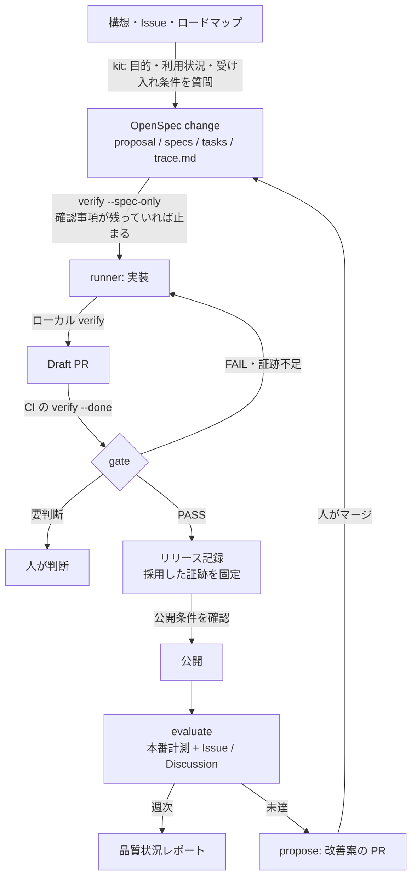
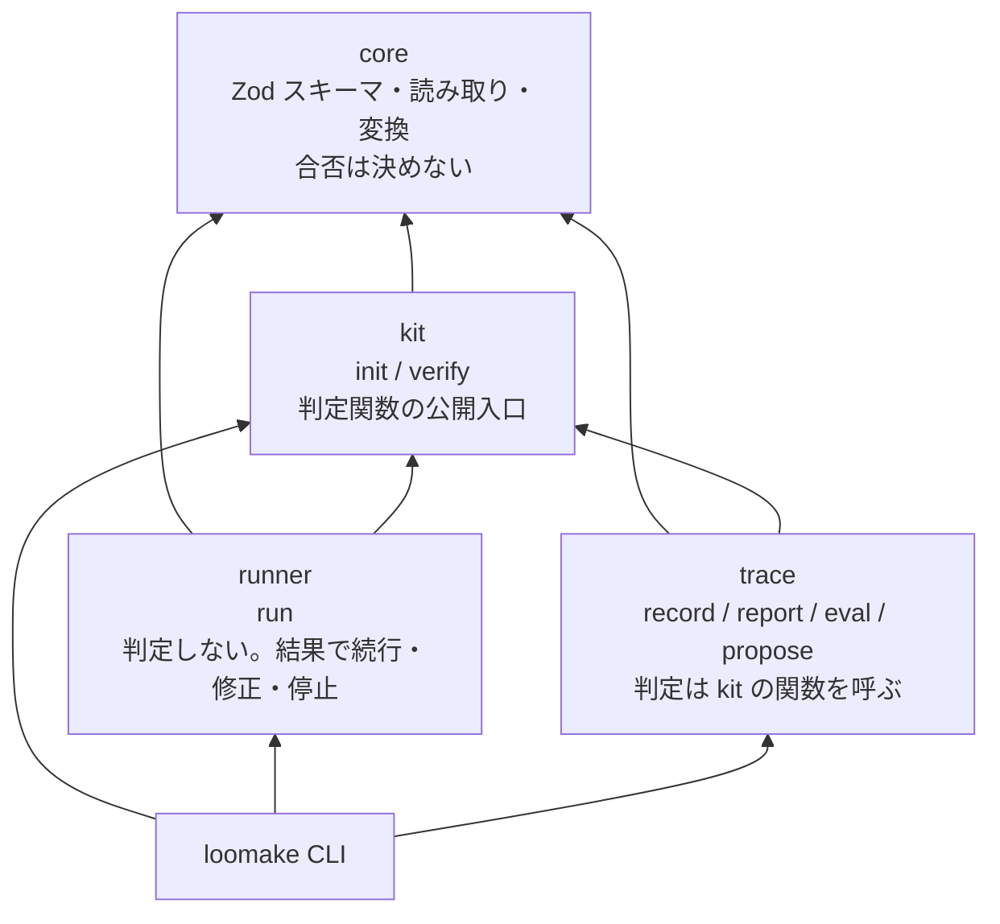
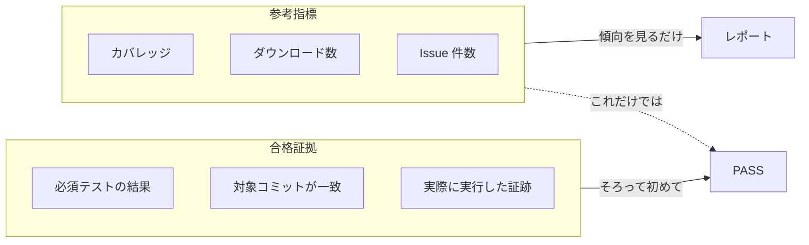
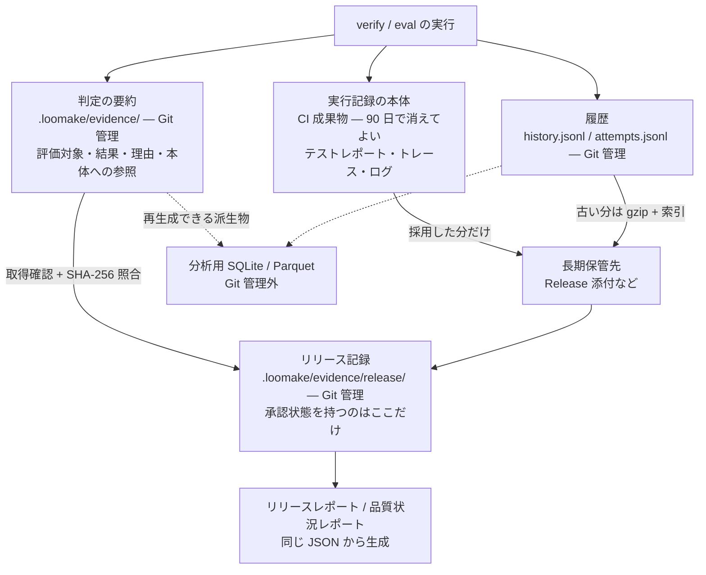

最終更新：2026-10-26

この文書は、Loomake がこれから向かう先をまとめたもの。いま動く機能と使い方は [README](https://github.com/loomake/loomake/blob/main/README.md) と [usage.md](../1.getting-started/2.usage.md) にある。ここに書いた流れとコマンドには、まだ実装していないものが含まれる。正本は [要件定義 v0.11](https://github.com/loomake/loomake/blob/main/docs/requirements/loomake-v0.11.md) と [アーキテクチャ v2.5.4](https://github.com/loomake/loomake/blob/main/docs/architecture.md) で、着手の順は [WBS](https://github.com/loomake/loomake/blob/main/docs/wbs.md)、要件と作業の対応は [要件対応表](https://github.com/loomake/loomake/blob/main/docs/requirements-matrix.md) にある。

**品質駆動開発のツール群。** 構想や Issue から仕様を起こし、完了ゲート（verify）が通るまで AI に実装を回し、リリースの根拠を残し、使われた結果を次の仕様に戻す。

対象は自社プロダクトと OSS（Loomake 自身を含む）。1 人で保守できる規模に保ち、人・CI・AI エージェントが同じ判定処理を使う。

## なぜ作るか

AI 駆動開発の道具は揃ってきた。仕様駆動、クラウドのエージェント、AI レビュー。それでも次の 3 つは人手に残っている。

1. **入口**：構想や要件を、検証できる仕様と品質条件に落とす
2. **判定**：「テストが通った」ではなく「仕様と品質目標を満たした」と確かめる
3. **根拠**：何を、どの版で、どう確かめてリリースしたかを、あとから追える形で残す

AI は「テストが通る」で止まる。テストに書いていない受け入れ条件は抜け、古い結果や緩めた基準が完了報告に紛れ込む。Loomake は、人が決めた目標を計測できる形にし、「作って、測って、直す」の一周を AI で速く安くする。AI に品質を作らせるのではない。

## 全体の流れ



上半分が「作って証明する」、下半分が「測って戻す」。戻りは必ず OpenSpec change を経由し、評価が直接コードを変えることはない。

## 4 つのツール

| パッケージ | 役割 | 一言でいうと |
|---|---|---|
| **OpenSpec**（外部 OSS） | 仕様の書式 | 何を作るか |
| `@loomake/kit` | 入口、共通ルール、完了ゲート（verify）、判定関数 | どう作らせ、どう確かめるか |
| `@loomake/runner` | 仕様から PR まで実装を回す（Claude Code / Codex / OpenHands） | 作る |
| `@loomake/trace` | 証跡の記録、リリース記録、定期評価、改善提案 | 作ったと証明し、測って戻す |
| `@loomake/core` | 上の 3 つをつなぐスキーマと変換 | 契約 |



判定は 1 か所にしか置かない。CLI も runner も eval も、kit の同じ関数を呼ぶ。判定関数は入力から結果を返す通常の関数で、ファイル操作・外部コマンド・現在時刻は呼び出し側が扱う。同じ入力なら同じ結果になり、誤合格の原因を入力から特定できる。

## 品質をどう判定するか

### 4 値で返す

| 判定 | 意味 |
|---|---|
| `PASS` | 合格証拠がそろい、条件を満たした |
| `FAIL` | 有効な証拠で、条件の違反を確認した |
| `INSUFFICIENT_EVIDENCE` | 未実施、証跡不足、対象の不一致、標本不足。**合格にしない** |
| `NOT_APPLICABLE` | 適用しない。理由と確認者が必須 |

未評価は未評価のまま表示する。製品品質が PASS でも、利用時の品質を達成したとは推論しない。重大な未達を総合点で相殺しない。

### 合格証拠と参考指標を分ける



カバレッジが高くても、テストしやすい設計かは分からない。Issue が少なくても、不具合が少ない証拠にはならない。参考指標は集計するだけで、それだけで PASS にしない。

### AI の自己申告で合格にしない

エージェントが「テストを通した」と報告しても、それは自己申告として扱う。合否は verify が CI の実行結果と成果物で決める。テストを緩める変更（テストの削除、アサーションの減少、skip の増加、基準値の緩和）は検知し、通常の修正と分けて人が判断する。

## 証跡の 3 層

リリースの判断をあとから確かめられる状態を保ちながら、実行記録でリポジトリが太るのを防ぐ。



- **Git に入れるのは小さな構造化記録だけ。** 本体は入れない
- 要約は、実際に検証したコミットを指す。要約を追加したコミットへ置き換えない
- 固定した要約を改変すると、照合関数が検出して再利用しない
- 期限切れで本体を再確認できなくなっても、当時の判断は書き換えず「再確認不可」と分けて示す
- 分析用の DB は正本から作り直せる派生物。なくてもリリース判断は成立する

## 自動化のレベル

製品ごとに設定する。MVP は A2 まで実装し、初期設定は A1。

| レベル | 自動で行うこと | 人が担当すること |
|---|---|---|
| A0 提案 | 仕様案、品質要件案、改善案の生成 | 実行と公開 |
| A1 実装支援 | 実装、検証、修正、PR 作成 | 重要な設計判断と公開 |
| A2 条件付き反映 | 自動実行条件を満たす変更の自動マージ | 対象外の変更と公開方針 |
| A3 条件付き公開 | 限定公開、監視、定義済みの切り戻し | 重大例外と品質水準の変更 |
| A4 継続改善 | 計測から許可範囲の改善実験まで | 目的、優先順位、許容リスク |

自動マージは「保守性だから」「依存更新だから」という種類だけでは許可しない。許可パス内か、外部に見える挙動を変えないか、影響先の要件に合格証拠があるか、revert で戻せる大きさか。どれか 1 つでも外れたら人へ戻す。

## 人に残る作業

1. 利用者と利用状況を決め、目標値と許容リスクを `quality.yaml` に書く（最初に 1 回）
2. 要件の意図について AI の質問に答える
3. 自動実行条件を外れた PR をレビューする
4. 提案 PR の採否を決める（マージが採用の合図）
5. 基準の緩和、公開、目的や許容リスクの変更を判断する
6. 本番計測がないプロダクトで、利用者評価を取り込む
7. 週次の品質状況レポートを読み、しきい値を調整する

## 使い方（予定）

次のうち、いま動くのは `init`・`verify`・`run`・`trace record`・`trace report` で、`quality.yaml`・4 値判定・`--observation`・`--status`・`trace eval`・`trace propose` はこれから作る。現在の使い方は [usage.md](../1.getting-started/2.usage.md) を参照。

```bash
npx loomake init                 # テンプレートと quality.yaml の雛形、薄いワークフローを導入
loomake verify --spec-only       # 仕様に確認事項が残っていないか
loomake verify --done --json     # 完了ゲート。4 値判定を JSON で
loomake run <change>             # エージェントに実装させ、CI の verify が通るまで回す
loomake trace record             # 証跡を記録。--observation で利用者評価を取り込む
loomake trace report             # リリースレポート。--status で品質状況レポート
loomake trace eval               # 定期評価
loomake trace propose            # 未達から改善案の PR
```

案件側のリポジトリに置くのは、`quality.yaml`、`openspec/`、共通ルール、証跡、レポートと、4 つのジョブ（run / gate / evaluate / propose）を呼ぶ薄いワークフローだけ。ジョブの本体は Loomake の reusable workflow にあり、複製しない。

## 設計原則（要約）

1. **標準機能を優先し、自作が複雑になる部分だけライブラリに任せる。** 実行時の依存は `zod` と `yaml` の 2 つ。外部ツール（`gh`、`claude`、`codex`、Biome、Playwright）は `spawn` で呼び、SDK を取り込まない
2. **責務を分離し、判定は通常の関数にする。** I/O・外部コマンド・現在時刻は呼び出し側
3. **状態の正本を情報の種類ごとに 1 つに定め、常駐基盤は必要になるまで持たない。** DB・キュー・常駐プロセスなし。派生物は正本から再生成する
4. **公開する契約を絞り、互換性の範囲を明示する。** JSON と設定は `version` を持つ
5. **品質判定と実行エラーを区別し、次の操作まで説明する。** 証跡を取れなかった不足を合格として扱わない
6. **原則を検証し、例外と見直しの理由を残す。** 機械で確認できる制約は CI、設計判断はレビューと ADR

## 進め方

| 段階 | 内容 | 閉じるループ |
|---|---|---|
| 1 | スキーマと 4 値判定、`init`、内部品質の定期評価、週次レポート、証跡の保管 | なし（週次で状況が出る） |
| 2 | gate：verify と AI レビューを必須チェックに、自動実行条件、条件付き自動マージ | なし |
| 3 | runner：Claude Code で 1 つの change を Draft PR からレビュー可能まで | 内側（実装） |
| 4 | propose：未達からリファクタ提案を一周 | 中（品質設計） |
| 5 | リリース記録とレポート、目的単位の E2E、利用者評価の取り込み | 外側（本番計測なし） |
| 6 | 本番計測を eval に自動で取り込み、限定公開と切り戻し | 外側（本番計測あり） |

段階 1〜5 は Loomake 自身のリポジトリで回す。受託案件で使うための差分（顧客の要件書、合意、検収）は要件定義の付録 B にまとめ、必要になるまで実装しない。

## 技術

TypeScript strict、Node.js LTS、ESM のみ、`tsc` のみ。実行基盤は GitHub Actions の reusable workflow。保存は JSON・JSONL・Markdown で、Git が正本。

Loomake 自身の開発には、pnpm workspaces・Vitest・ESLint・changesets を使う。2026-10-26 に、文書をリポジトリの構成に合わせると決めた（[ADR 0004](https://github.com/loomake/loomake/blob/main/docs/adr/0004-keep-development-stack.md)）。これらは開発時の道具で、配布物の実行時依存とは分けて扱う。

## 名前

旧称の Loomkit（kit）、Imploom（runner）、Traspec（trace）を **Loomake** に一本化した。npm は `@loomake/*`、CLI は `loomake`、サイトは loomake.dev。GitHub Organization と npm の `@loomake` スコープは取得済み。
