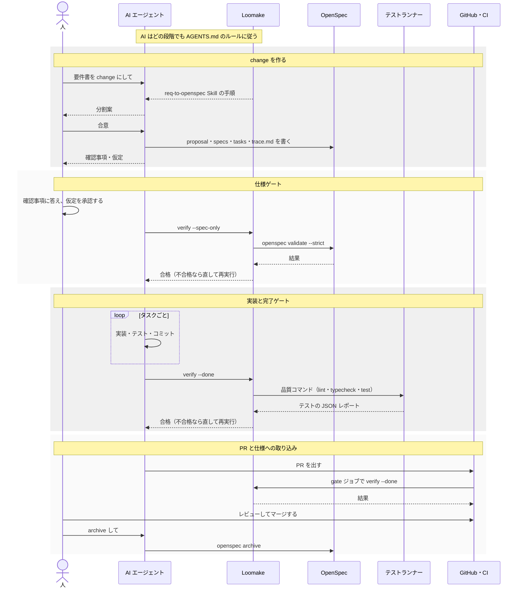

# Loomake の位置付け

最終更新：2026-10-22

Loomake を、OpenSpec・AI エージェント（Claude Code・Codex）・テストランナー・CI と組み合わせて使うときに、どの道具が何を受け持つかをまとめる。手順は [usage.md](usage.md)、パッケージの構成は [architecture.md](architecture.md) にある。

## 1. 一言でいうと

| 道具 | 受け持つこと | Loomake との関係 |
|---|---|---|
| OpenSpec | **何を作るか**：仕様の書式・change の置き場・検証（`openspec validate`）・仕様への取り込み（`openspec archive`） | 土台。Loomake は書式を自作せず、その上に足す |
| Loomake | **どう作らせ、どう確かめるか**：要件書からの入口、AI が従うルール、仕様ゲートと完了ゲート | この文書で扱う道具 |
| AI エージェント（Claude Code・Codex） | **作る**：change を書き、実装し、ゲートが通るまで直す | Loomake が置いた Skill とルールを読んで動く。Loomake はエージェントを起動しない |
| テストランナー（Vitest・Jest など） | テストを実行し、結果を JSON に書き出す | 完了ゲートがその JSON を読み、要件ごとのテストを確かめる |
| CI（GitHub Actions など） | PR ごとに品質コマンドと完了ゲートを実行し、不合格ならマージを止める | `loomake verify --done` を呼ぶだけ。CI の設定は利用者が書く |
| 人 | 分割案への合意、確認事項への回答、仮定の承認、PR のレビュー | Loomake は、人が判断すべき点を確認事項として切り出す |

Loomake は仕様の書式でも、AI エージェントでも、テストランナーでもない。それらのあいだに入り、「推測で埋めさせない」「全要件にテストがあることを確かめる」という 2 つの約束を守らせる。

## 2. 開発の流れの中での位置

1 つの change が進むあいだに、どの段階でどの道具が動くかを示す。縦の列が道具ごとのレーンで、上から下へ時間の順に進む。

| 段階 | 人 | AI エージェント | Loomake | OpenSpec | テストランナー・CI |
|---|---|---|---|---|---|
| 導入 | `npx loomake init`・`openspec init` を実行する | — | AGENTS.md・CLAUDE.md・設定・Skill を置く | `openspec/` を作る | テストランナーに JSON レポートを書き出させる |
| change を作る | 分割案に合意する | Skill の手順で台帳・確認事項・change を書く | req-to-openspec Skill が手順と trace.md の雛形を与える | change の書式（proposal・specs・design・tasks） | — |
| 仕様ゲート | 確認事項に答え、仮定を承認する | 指摘に沿って spec.md を直す | trace.md と spec.md の対応、未回答のブロッキング確認事項を確かめる | `openspec validate --strict` を verify から呼ばれる | — |
| 実装 | 仕様外の質問に答える | tasks.md を順に実装し、タスクごとにコミットする | AGENTS.md が禁止事項と完了の定義を決める | — | テストを実行する |
| 完了ゲート・PR | PR をレビューしてマージする | ゲートが通るまで直し、PR を出す | 品質コマンドを実行し、要件ごとのテストと tasks.md を確かめる | — | CI が PR ごとに `verify --done` を実行する |
| 仕様に取り込む | archive を頼む | `openspec archive` を実行する | 関わらない | 差分仕様を `openspec/specs/` に統合する | — |

## 3. OpenSpec との分担

### 3.1 Loomake が使うもの・足すもの

| 項目 | OpenSpec | Loomake |
|---|---|---|
| 仕様の書式（Requirement・Scenario・差分の操作） | 定義する | そのまま使う。Requirement に `Source: REQ-xxx` を書く決まりだけを足す |
| change の置き場（`openspec/changes/<id>/`） | 定義する | そのまま使う |
| proposal.md・specs・design.md・tasks.md | 定義する | そのまま使う |
| trace.md（要件台帳・確認事項・仮定） | 持たない | **足す**。要件書の出典と、人の判断が要る点をここに集める |
| 要件書（Markdown）からの取り込み | 持たない | **足す**（req-to-openspec Skill） |
| 書式の検証 | `openspec validate` | 仕様ゲートの中で呼ぶ。CLI が無いときは、設定 `openspecValidate` に従って警告か不合格にする |
| 要件とテストの対応 | 持たない | **足す**（完了ゲート） |
| 仕様への取り込み | `openspec archive` | 関わらない。OpenSpec のコマンドをそのまま使う |

`openspec/specs/` を直接書き換えないという AGENTS.md の決まりは、OpenSpec の「仕様は change を通して変え、archive で反映する」という考え方を、AI に守らせるためのものである。

### 3.2 OpenSpec の Skill（`/opsx:*`）との使い分け

`openspec init` で Claude Code や Codex を選ぶと、OpenSpec 自身の Skill とコマンド（`/opsx:propose`・`/opsx:apply`・`/opsx:archive` など）も入る。Loomake と一緒に使うときは、次の点に気をつける。

| OpenSpec の Skill | Loomake と一緒に使うとき |
|---|---|
| `/opsx:propose`（change を作る） | trace.md と `Source:` を書かないので、作った change は仕様ゲートを通らない。要件書から change を作るときは req-to-openspec Skill を使う |
| `/opsx:explore`・`/opsx:update`（考える・change を直す） | 使ってよい。直したあとで仕様ゲートを通し直す |
| `/opsx:apply`（tasks を実装する） | 使ってよい。ただし、実装の前後に仕様ゲートと完了ゲートを通すことは AGENTS.md の決まりで、Skill は代わりにならない |
| `/opsx:archive`（仕様に取り込む） | 使ってよい。マージのあとに実行する |

要件書のない小さな変更を `/opsx:propose` で作る場合も、ゲートを通すには trace.md を足し、各 Requirement に `Source:` を書く必要がある。

## 4. AI エージェントとの分担

Loomake は AI エージェントを起動も制御もしない。エージェントが読むファイルを置き、エージェントの成果をゲートで確かめるだけである。

| Loomake が置くもの | Claude Code | Codex |
|---|---|---|
| 共通ルール | `CLAUDE.md`（中身は `@AGENTS.md`）から AGENTS.md を読む | AGENTS.md を直接読む |
| req-to-openspec Skill | `.claude/skills/req-to-openspec/` | `.agents/skills/req-to-openspec/`（`init --codex` のとき） |
| 開発環境 | `init --devcontainer` で Claude Code 入りの devcontainer を置く | — |

ルールは次の 2 段で守らせる。

1. AGENTS.md：AI に守るよう求める。テストを弱めない、曖昧なら止まる、設定を緩めない、など。守るかどうかは AI しだい
2. verify：守ったかを機械的に確かめる。AI が「完了」と言っても、ゲートが不合格なら完了ではない

実装を自動で回す `@loomake/runner`（verify が通るまでエージェントを動かす）は、MVP の範囲外で、まだ作っていない。いまは人がエージェントに依頼文を渡して実装させる。

## 5. テストランナー・CI との分担

- Loomake はテストを書かず、テストランナーも持たない。完了ゲートは設定 `commands` の品質コマンド（lint・typecheck・test）を実行し、テストランナーが書き出した JSON レポート（既定は `.loomake/test-report.json`）を読む
- 要件とテストは、テストの名前に入れた要件 ID（`[REQ-012]` など）だけでつながる。成功したテストだけを数え、skip・todo と失敗したテストは数えない
- CI では `loomake verify --change <id> --done` を実行する。結果は終了コード（0 合格、1 不合格、2 使い方の誤り）で分かり、`--json` を付ければ JSON でも出せる。マージを止める必須チェックの設定は、利用者が GitHub 上で行う

## 6. Loomake がしないこと

| しないこと | 代わりに使うもの |
|---|---|
| 独自の仕様書式を作る | OpenSpec |
| Markdown 以外の要件書（Word・Excel・PDF）を読む | 先に Markdown へ変換する |
| AI エージェントを起動して実装を回す | 人が依頼する（将来は `@loomake/runner`） |
| テストを実行するランナーになる | Vitest・Jest など |
| 検収レポートを作る | いまは人がまとめる（将来は `@loomake/trace`） |
| 見積・工数管理、GUI、Web ダッシュボード | 範囲外 |

## 7. このリポジトリだけで使う道具

次は Loomake 自身を開発するために使っているもので、`loomake init` は利用者のプロジェクトに置かない。

| 道具 | 使い方 |
|---|---|
| `pnpm -s verify` | ビルドしてから `loomake verify` を実行するスクリプト。このリポジトリではゲートをこれで通す |
| yomiyasu Skill | 日本語の文章を推敲する。AGENTS.md の決まり |
| changesets | パッケージごとにバージョンを上げ、npm に公開する |
| `scripts/ci-gate.mjs` | PR のブランチ名が change-id と一致すれば、CI で完了ゲートを実行する |
