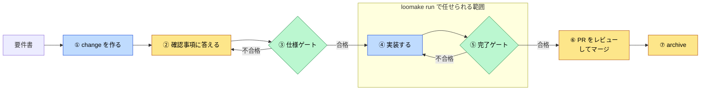
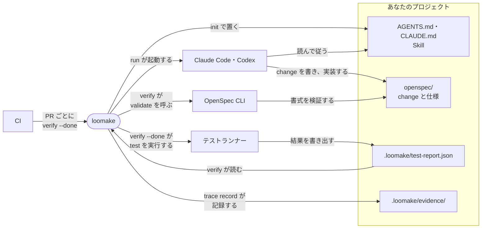

# Loomake クイックスタート

Loomake を初めて使う人向けに、導入から 1 つの change を終えるまでと、ほかの道具との違いと連携を 1 ページにまとめる。各手順の詳しい説明とオプションは [usage.md](usage.md) にある。

## 用意するもの

- Node.js 22.12 以上
- OpenSpec CLI：`npm install -g @fission-ai/openspec`
- Claude Code または Codex
- Markdown（.md）の要件書。Word・Excel・PDF は先に Markdown に変換する

## 1. 導入する

プロジェクトのルートで実行する。

```sh
npx loomake init          # AGENTS.md・CLAUDE.md・loomake.config.json・Skill を置く
pnpm add -D loomake       # 検査に使う版を固定する（npm なら npm install -D loomake）
openspec init             # openspec/ が無いとき
```

> `loomake` はまだ npm に公開していない。公開するまでは、このリポジトリで `pnpm build` したあと、`node <このリポジトリ>/packages/cli/dist/cli.js init` を使う。

続けて、次の 3 つを設定する。

1. テストランナーが結果を JSON で `.loomake/test-report.json` に書き出すようにする（Vitest なら `reporters: ['default', 'json']` と `outputFile: { json: '.loomake/test-report.json' }`）
2. `.gitignore` を確かめる。init はテストのレポート（`.loomake/test-report.json`）の行を足す。`.loomake/evidence/` はコミットするので、`.loomake/` を丸ごと除外しない
3. `AGENTS.md` の末尾の「プロジェクト固有の情報」を書き換える

## 2. 1 つの change を進める



黄色は人、青は AI エージェント、緑は `loomake verify` が受け持つ。

| 手順 | 誰が | すること |
|---|---|---|
| ① change を作る | AI | 「req-to-openspec スキルで docs/requirements/order-v1.0.md を change にして」と頼む。分割案に合意すると `openspec/changes/<change-id>/` ができる |
| ② 確認事項に答える | 人 | `trace.md` の確認事項に回答を、仮定に承認を書く（回答者・承認者と日付も） |
| ③ 仕様ゲート | verify | `npx loomake verify --change <change-id> --spec-only` が合格するまで②に戻る |
| ④ 実装する | AI | change-id と同じ名前のブランチで「tasks.md を順に実装して。タスクごとにコミット」と頼む |
| ⑤ 完了ゲート | verify | `npx loomake verify --change <change-id> --done` が合格するまで④に戻る |
| ⑥ PR とマージ | 人 | PR をレビューしてマージする |
| ⑦ archive | 人 | `openspec archive <change-id>` を実行してコミットする |

④と⑤は `npx loomake run --change <change-id>` で AI に任せられる。run は完了ゲートが通るまで直させ、証拠を記録して PR を作る。初めは `--dry-run` で、渡すタスクと指示を確かめる。

## 3. テスト名の決まり

完了ゲートは要件 ID を名前に含む**成功した**テストがあるかを、要件ごとに確かめる。skip したテストや失敗したテストは数えない。

```ts
it('[REQ-012] 未ログインのとき 401 を返す', ...);
it('[REQ-012][REQ-013] 1 つのテストで複数の要件を確かめる', ...);
```

## 4. リリースレポートを作る

完了ゲートを通したコミットで実行する。

```sh
npx loomake trace record --change <change-id>        # 検査結果を証拠として記録する
git add .loomake/evidence && git commit -m "evidence: <change-id>"
npx loomake trace report --change <change-id> > report.md
```

## 5. ほかの道具との違いと連携

Loomake は仕様の書式でも、AI エージェントでも、テストランナーでもない。それらのあいだに入り、未確定の要件を推測で埋めさせないことと、全要件にテストがあることを確かめる。



| 道具 | 受け持つこと | Loomake との連携 |
|---|---|---|
| OpenSpec | 仕様の書式、change の置き場、書式の検証（`openspec validate`）、仕様への取り込み（`openspec archive`） | 書式はそのまま使い、trace.md と、Requirement の `Source: REQ-xxx` を足す。仕様ゲートの中で `openspec validate --strict` を呼ぶ |
| Claude Code・Codex | change を書き、実装し、ゲートが通るまで直す | init が置いた AGENTS.md と Skill を読んで動く。Claude Code は CLAUDE.md を通して AGENTS.md を読む。Codex には `init --codex` で `.agents/skills/` にも Skill を置く。`loomake run` は Claude Code を動かして実装させる |
| テストランナー（Vitest・Jest など） | テストを実行し、結果を JSON に書き出す | 完了ゲートが `.loomake/test-report.json` を読み、テスト名の要件 ID で要件とテストを結びつける |
| CI（GitHub Actions など） | PR ごとに検査を実行し、不合格ならマージを止める | `loomake verify --change <id> --done` を実行する。必須チェックの設定は利用者がする |

### OpenSpec の Skill と一緒に使う

`openspec init` で Claude Code や Codex を選ぶと、OpenSpec の Skill（`/opsx:*`）も入る。

| OpenSpec の Skill | Loomake と一緒に使うとき |
|---|---|
| `/opsx:propose` | trace.md と `Source:` を書かないので、作った change は仕様ゲートを通らない。要件書から change を作るときは req-to-openspec Skill を使う |
| `/opsx:explore`・`/opsx:update` | 使ってよい。change を直したあとで仕様ゲートを通し直す |
| `/opsx:apply` | 使ってよい。実装の前後に仕様ゲートと完了ゲートを通す決まりは変わらない |
| `/opsx:archive` | 使ってよい。マージのあとに実行する |

### CI で完了ゲートを実行する

GitHub Actions ではたとえば次のように書く。ブランチ名は `env` で渡す。`run` に `${{ github.head_ref }}` を直接書くと、ブランチ名に仕込まれたコマンドが CI で動くおそれがある。

```yaml
- run: npm ci
- run: npm install -g @fission-ai/openspec
- run: npx loomake verify --change "$HEAD_REF" --done
  env:
    HEAD_REF: ${{ github.head_ref }}
```

ブランチ名と change-id をそろえておくと、PR のブランチ名をそのまま渡せる。change ではないブランチでは `--change` を付けずに実行し、品質コマンドだけを確かめる。

要件定義から運用までの一般的な開発の流れの中で、どの道具がどこを受け持つかは [positioning.md](positioning.md) の 2 章に、図と表で示している。

## コマンドの一覧

| コマンド | すること |
|---|---|
| `loomake init` | AGENTS.md・設定・Skill を置く。既存のファイルと違えば差分を見せて上書きするか聞く |
| `loomake verify --change <id> --spec-only` | 仕様ゲート：未回答のブロッキング確認事項や仕様の不備が無いか |
| `loomake verify --change <id> --done` | 完了ゲート：タスク・品質コマンド・要件ごとのテスト |
| `loomake verify` | 品質コマンドだけを実行する |
| `loomake run --change <id>` | 実装から PR までを AI に任せる |
| `loomake trace record --change <id>` | verify の結果を証拠として記録する |
| `loomake trace report --change <id>` | リリースレポートを出す（`--format json` で JSON） |

終了コードは合格（警告を含む）なら 0、不合格なら 1、使い方や設定の誤りなら 2、外部操作が時間・出力の上限か中断で止まったときは 3。

## うまくいかないとき

| 症状 | 対処 |
|---|---|
| 「テストのレポート（.loomake/test-report.json）がありません」 | テストランナーの JSON レポートを設定する（1 章） |
| 「テストが無い要件：REQ-012」 | 名前に `[REQ-012]` を含むテストを足すか、skip・失敗を直す |
| 仕様ゲートが不合格 | 表示された確認事項に答えるか、仕様の不備を直して、もう一度実行する |
| `loomake init` が終了コード 1 で止まる | CI などで既存のファイルと差があった。端末から実行し直す |

ほかの症状と設定の詳細は [usage.md](usage.md) の 5〜8 章を見る。
