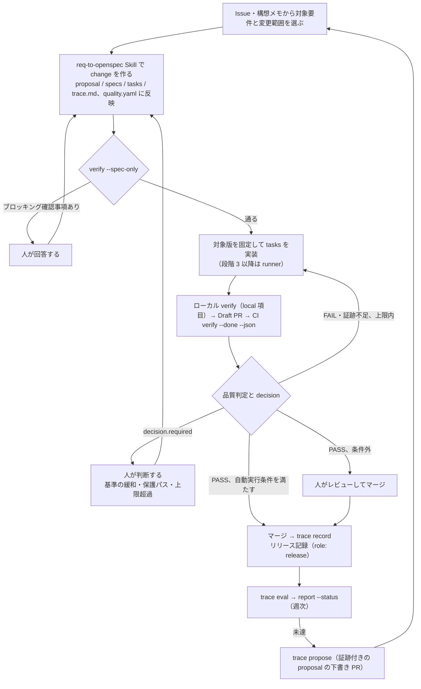

# Loomake 完成までのワークフローと WBS

最終更新：2026-10-26（v1.3.2 参照する正本を要件定義 v0.11.2・アーキテクチャ v2.5.4 に更新し、W0-2 の道具をリポジトリの構成（pnpm workspaces・Vitest・ESLint）に合わせた（ADR 0004）。v1.3.1 PR #66 のレビュー反映。1 章の「初回完成に含めないもの」の追加エージェントを OpenHands など Claude Code・Codex 以外に限定し、W3-6 の Codex 切り替えと矛盾しないようにした。W3-8 の行を W3 の表につないだ。v1.3 要件対応表（W0-1）で見つかった未割り当ての反映。W2-3 に FR-20、W1-6 にマスキング、W1-14 に履歴の切り出し、W3-8 にシナリオ操作の列挙を追加。v1.2.1 着手時の確認 2 点。衝突の検出を要件対応表と W7 に結び付け、ハッシュの取得順と取り込み前の再照合を書いた。v1.2 レビュー反映。参照する正本を要件定義 v0.11.1・アーキテクチャ v2.5.3 に更新し、固定方法を版・更新日・SHA-256 に、移行後はコミット SHA の追記に変えた。重い E2E の再実行条件。W3-1 を構成の選定から 9 章の構成の検証手順に変更。W0-2 に文書の取り込み。A24〜A27 を対象外に明記。v1.1 レビュー反映。A11 の扱い、参照した正本の版と見直し手順、計測様式の前倒し（W0-7）、AI レビューの実行方法、初回完成と初回配布の区別、段階の出口に含める回帰確認、要件対応表の列と C-001〜003 の完了範囲。v1.0 初版。要件定義 v0.11 の 10 章とアーキテクチャ v2.5 の 7 章を基に、段階を作業項目に分けて依存と完了条件を付けた）
関連：`docs/requirements/loomake-v0.11.md`（10 章が段階と出口の正本）、`docs/architecture.md`（7 章が各段階で実装する内容）
正本：`loomake/loomake` の `docs/wbs.md`（2026-10-25 にコミット ecbe7fc で取り込み。以後はこのファイルが正本）

この文書は段階計画を変えない。段階 1〜6 の中身と出口は要件定義 10 章のままで、ここではそれを着手の順に並べ、作業ごとに成果物・依存・完了条件を書く。段階の内容を変えるときは要件定義を先に直し、この文書を追従させる。

参照した正本の版：要件定義 v0.11.2（8 章の開発の道具をリポジトリに合わせ、11 章の O15 に版管理の結果を書いた版、2026-10-26）、アーキテクチャ v2.5.4（5 章・6 章・8 章の開発の道具と版管理をリポジトリに合わせた版、2026-10-26）。v0.11.2・v2.5.4 の改訂で見直した作業 ID は W0-2 と W0-6 で、W0-2 の作業の列だけを直した。v1.1 まで参照していた v2.5 は v2.5.1〜v2.5.3 の改訂に追従していなかったもので、意図した採用ではない。

固定の方法：Git 管理前は、文書冒頭の版番号・最終更新日・本文の SHA-256 で固定する。SHA-256 は W0-1 で 2 本の正本から取り、要件対応表の冒頭に記録する。W0-2 でモノレポの `docs/` に要件定義・アーキテクチャ・この WBS を取り込んで以後の正本とし、取り込んだ時点でリポジトリ・パス・コミット SHA を版の記載に追記する（版番号と更新日は人が参照するために残す）。取り込む本文は W0-1 で取った SHA-256 と照合し、一致しなければ W0-1 以降の改訂として影響する作業 ID を見直し、版と SHA-256 を更新してから取り込む。プロジェクト側の既存文書には取り込みのあとで移行先と移行日を書き、固定の対象は追記前の本文とする。正本を二重にしない。正本を改訂したときは、改訂した章を参照する作業 ID をこの文書から探し、依存・完了条件・出口を見直してから版の記載を更新する。見直しの対象が分かるよう、各作業の列には参照する章番号を残す。

## 1. 完成の定義

初回完成は要件定義 10 章の段階 1〜5（MVP）を Loomake 自身のリポジトリで回し、段階横断の受入シナリオ A23（目的からアプリを作って公開し、要望を change に戻して改善版を公開するまで）が一周することとする。加えて、別リポジトリから `npx loomake init` で導入でき、案件側の薄いワークフローで run・gate・evaluate・propose を呼べる状態を含める。

完了の範囲は 2 つに分ける。W5 の出口（A23 の一周）を主要機能の初回完成、W6-3 の別リポジトリでの導入検証の完了を初回配布完了と呼び、今回の目標は初回配布完了までとする。

初回完成に含めないもの：段階 6（本番計測の自動取り込み、限定公開と切り戻しの A3。出口の A11 は段階 6 にあり、今回の対象外。A24〜A27 は段階 6 以降の比較評価で、段階 6 の必須の出口にも入らない）、管理画面、他の SDD ツールへの対応（O18）、OpenHands など Claude Code・Codex 以外の追加エージェント（Codex への切り替えは W3-6 で段階 3 に含める）、受託プロファイル（要件定義の付録 B）。これらは完成後に、必要性と検証結果を見て個別に採用する。

## 2. 全体の流れ

```
段階 1  core・kit・trace    契約と判定を固め、要件 → 実装 → 証拠 → 状況が一周する
   │                       出口：A03 A04 A15 A16 A17 A20 A22
   ▼
段階 2  gate               PR 側の判定を必須チェックにし、自動実行条件を判定する
   │                       出口：A08 A12 A13 A21
   ▼
段階 3  runner             1 つの change を Draft PR からレビュー可能まで自動で回す（内側のループ）
   │                       出口：A01 A02 A05 A06 A07
   ▼
段階 4  propose            未達からリファクタ提案を一周させる（中のループ）
   │                       出口：A09 A14
   ▼
段階 5  release            リリース記録・E2E 生成・利用者評価で外側のループを閉じる
   │                       出口：A10 A18 A19 A23 ＝ 初回完成
   ▼
配布    npm・workflow・文書   段階 1 の出口から始め、段階ごとに更新する（並行）
                           出口：W6-3 の導入検証 ＝ 初回配布完了
```

段階 1 の前半（アーキテクチャの順 0）を準備として切り出し、WBS では W0 とした。配布は独立した段階ではなく、段階 1 から並行して進める作業として W6 に置く。

## 3. 各 change を進めるワークフロー

Loomake 自身の開発も、このワークフローに自己適用する。段階が進むごとに、自動化できる箇所が増える。



判定の順序は verify と eval で共通（版の確認 → 証跡の適格性 → 実施確認 → 条件 → 集約 → 自動実行条件 → 根拠）で、kit の判定関数を両方から呼ぶ。評価が直接コードを変えることはなく、改善は必ず propose → change → 実装の経路を通る。仕様が変わった場合は固定した仕様版との対応を確認し、`verify --spec-only` へ戻る。archive、タスクの完了、リリース記録はそれぞれ別の操作として扱う。

## 4. WBS

ID は W<段階>-<連番>。依存の列は着手の前に完了していることが要る項目。完了条件は人が確認できる 1 つの状態で書く。

各段階の出口はその段階で追加した受入シナリオに加え、前の段階までの必須の回帰確認を含む。回帰確認の範囲は、契約テスト（W1-2）、判定関数の同じ入力で同じ出力のテスト（W1-4）、gate の必須チェック（W2-1）、障害注入テスト（W3-4）のうち、その時点で存在するものとし、CI で毎回実行する。目的単位の E2E など重い検証は、出口判定の対象となるコード・設定・テンプレートで成功していることを条件とし、成功後にそれらへ変更が入ったら出口判定の前に再実行する。修正前の成功結果で出口を通過させない。再実行の要否は 7.9 の再利用の条件（検証済みコミットと対象コミットの差分が証跡ファイルだけか）と同じ規則で判定する。

### W0 準備（段階 1 の前半）

| ID | 作業 | 成果物 | 依存 | 完了条件 |
|---|---|---|---|---|
| W0-1 | 現行文書と実装の棚卸し。要件定義・アーキテクチャ・現行 `verify.mjs` を突き合わせ、要件対応表を「要件 ID → 対応 WBS ID → 検証方法・シナリオ ID → 証跡 → 対象段階」の列で作る。最初は対応先のない要件を見つけるところまでとし、受入基準の書き起こしは各段階の着手時に行う。要件定義 10 章の「既存の定義との対応」にある衝突の検出（実装・検証は段階 6 以降）も要件として行に入れ、対応 WBS を W7 とする | 要件対応表 | なし | FR・NFR の全件に対応 WBS ID と対象段階が入るか、対応先なしと記される |
| W0-2 | モノレポの骨組み。pnpm workspaces、packages/core・kit・trace・runner・cli、各 `package.json` の `exports`、tsc（ESM、`.d.ts`）、Vitest、ESLint、devcontainer。`docs/` に要件定義・アーキテクチャ・この WBS を取り込み、版の記載にリポジトリ・パス・コミット SHA を追記する | `loomake/loomake` の骨組み、`docs/` | W0-1 | 空のパッケージで build・test・lint が通り、3 本の文書の正本がリポジトリ側になっている |
| W0-3 | 最小 CI。`dependencies` の予算照合（core は zod、kit は yaml のみ）、SDK 不在の照合、判定ディレクトリの import とグローバル参照の制限、JSON Schema の差分検査 | CI ワークフロー | W0-2 | 原則に反する変更を CI が落とす |
| W0-4 | 自己適用の文書。AGENTS.md・CLAUDE.md（Loomake 自身を開発するための共通ルール）、CONTRIBUTING.md、SECURITY.md | 開発文書 | W0-2 | AI エージェントが文書だけで開発環境と検証コマンドを把握できる |
| W0-5 | 未決事項の決め時の割り当て。O02（常駐基盤）、O09（traspec の取り込み）、O13（@loomake の取得状況の反映）、O14・O16（保管の既定値）、O17（OpenSpec の運用適合）、O18（他 SDD）を、どの段階のどの作業で確認するかを決める | 未決事項の表の更新 | W0-1 | 各未決事項に確認する段階と作業 ID が付く |
| W0-6 | 版管理の方式（changesets か `npm version`）と `0.x` の互換性の方針を決める | ADR | W0-2 | 方式が決まり、CONTRIBUTING.md に書かれる |
| W0-7 | 開発効率の記録様式を決める。比較の種類と作業範囲（FR-49 の baseline）、事前の人力見積もり、指示・レビュー・手直し・実行・待機の時間の記録方法（7.8）。集計は W1-9 で実装し、ここでは手書きの様式でよい | 記録様式と最初の見積もり | W0-1 | C-001 の着手前に様式があり、C-001 の事前見積もりが記録されている |

### W1 段階 1：契約と判定（core・kit・trace）

| ID | 作業 | 成果物 | 依存 | 完了条件 |
|---|---|---|---|---|
| W1-1 | core：Zod スキーマと型。trace.md・spec・tasks・quality.yaml・verify JSON・quality-report に形式の `version` を付け、JSON Schema を書き出す | `@loomake/core` のスキーマ | W0-2 | スキーマから型を導出し、JSON Schema の書き出しが CI で差分を出さない |
| W1-2 | core：要件定義 7.3 の契約テスト。ci の completed・partial、local の completed・partial、aborted の各構造、終了コード 0〜3 の優先順、`decision`、既知の禁止フィールド、未知フィールドの許容 | 契約テスト | W1-1 | 7.3 の表の各行に対応するテストがあり、通る |
| W1-3 | core：テストレポートと CI 成果物の変換処理。取得済みの入力を共通形式へ変換し、合否は決めない | 変換処理 | W1-1 | 代表的な形式の fixture が共通形式に変換される |
| W1-4 | kit：判定関数。版の確認 → 証跡の適格性 → 実施確認 → 条件 → 集約 → 自動実行条件 → 根拠の順で、I/O・外部コマンド・現在時刻を持たない通常の関数として実装し、`exports` から公開する | `@loomake/kit` の判定関数 | W1-1、W1-3 | 同じ入力で同じ出力になるテストが通り、未実行・不足・古い・不適合の証跡を合格にしない |
| W1-5 | kit：`verify --spec-only` / `--done` / `--json`。stdout は JSON のみ、診断は stderr、非対話環境で入力待ちにしない | `loomake verify` | W1-2、W1-4 | 関数 API と CLI の判定結果が一致し、`CI=1` で主要コマンドが走る |
| W1-6 | kit：外部コマンドの共通 `spawn` 関数と証跡の収集。`gh`・`claude`・`codex`・Biome・Playwright の JSON 出力を読み、core の変換処理に渡す。収集した出力は保存前に秘密情報をマスキングする（NFR-09）。証跡を初めて保存する W1-10 の依存先 | 収集モジュール、マスキング処理 | W1-3 | ツール固有の変更が呼び出し処理と変換処理に閉じ、秘密値がログ・証跡・レポートに残らないテストが通る |
| W1-7 | kit：req-to-openspec Skill。Issue・Markdown の要件メモから change を作り、目的・利用状況・受け入れ条件を quality.yaml に反映する。ブロッキング確認事項を要件に紐づけて残す（FR-01〜03） | Skill | W1-5 | 要件メモから change が生成され、確認事項があれば `--spec-only` が止まる |
| W1-8 | kit：`init`。テンプレート（Skill・AGENTS.md・CLAUDE.md・devcontainer）、quality.yaml v2 の雛形、案件側の薄いワークフロー（FR-04） | `loomake init` | W1-5 | 空のリポジトリで `npx loomake init` が通り、導入物の一覧が出る |
| W1-9 | kit・trace：開発効率の計測。人力工数の推定（FR-49）と `record --effort`、効率の表（FR-50）。W0-7 で手書きした記録を取り込む | 計測の入口 | W0-7、W1-5 | C-001〜003 の手書きの記録を含め、change ごとに推定と実績が表に出る |
| W1-10 | trace：証跡の保管（7.9）。判定の要約・実行記録の本体・リリース記録の 3 層、`.loomake/evidence/` に残すものと CI 成果物に置くものの分離、既存記録の整理、quality.yaml の `evidence:`。長期保管先への自動転送は W5-1、履歴の切り出しは W1-14 | 保管の決まりと整理 | W1-5、W1-6 | Git に残るのが要約・索引・リリース記録だけになり、本体への参照が要約から辿れる |
| W1-11 | trace：`eval`（内部品質の静的指標のみ）と `history.jsonl`、`report --status`（週次の品質状況レポート）。判定は kit の関数を呼ぶ | `loomake trace eval` / `report --status` | W1-4、W1-10 | 週次でレポートが出て、未測定が「未評価」と表示される |
| W1-12 | A16 の改変検出。リリース記録の本実装を待たず、固定 fixture のリリース記録で確認する | テスト | W1-10 | fixture の改変を検出する |
| W1-14 | trace：履歴の切り出し（7.9）。history.jsonl・attempts.jsonl を容量・期間（仮置きは O14）で区切り、gzip で長期保管先に保存し、SHA-256 と索引を Git にコミットしてから別コミットで Git 管理から外す。段階 1 の後続タスクで、段階 1 の出口には含めない | 切り出し処理、索引 | W1-10、W1-11 | 切り出し後も索引から保持期間中の履歴を取得・照合でき、通常の検証とリリース判断が派生物なしで成立する |
| W1-13 | 自己適用。Loomake 自身の Issue と要件メモを 1〜2 本流し、要件定義 O17 の 4 点（OpenSpec の運用適合）を運用で確認して O17 に記録する。使った実績から配布雛形を直す | O17 の記録、雛形の修正 | W1-7〜W1-11 | 要件 → 実装 → 証拠 → 状況が一周し、O17 に結果が書かれる |

出口：A03、A04、A15、A16、A17、A20、A22。A23 の到達点は「店の管理アプリの仕様・検証結果・証跡を既定のコマンドとレポートで扱える」。

### W2 段階 2：gate

| ID | 作業 | 成果物 | 依存 | 完了条件 |
|---|---|---|---|---|
| W2-1 | reusable workflow `gate`。verify を必須チェックにする | `.github/workflows/gate.yml` | W1-5 | verify が落ちた PR はマージできない |
| W2-2 | AI レビューを必須チェックにする。実行はワークフロー側の `anthropics/claude-code-action` で行い、runner には依存しない。最初は 1 本。レビュー結果は W1-6 の収集モジュールで証跡にする | ワークフロー | W1-6、W2-1 | runner がない状態でレビューが走り、結果が証跡として記録される |
| W2-3 | 変更種別と自動実行条件の判定（実装前・マージ前。要件定義 7.5）。`protected_paths` の判定。確認済みの操作の保持（FR-20）：確認の範囲・版・有効期限を保存し、再利用できる範囲と、内容が変わったときに再確認する条件を定める | 判定ルール、確認の記録 | W1-4、W2-1 | 進行可否と理由が記録される。同じ範囲・版の確認を聞き直さず、範囲・版・期限のどれかが変わると再確認に戻るテストが通る |
| W2-4 | 自動マージ（A2）。実装するが初期設定は A1 で無効 | 設定 | W2-3 | 有効化すると条件を満たす変更だけがマージされる |
| W2-5 | GitHub App と権限の分離。エージェント実行用と、最終判定・マージ・リリース承認用を分け、エージェントに判定を承認済みにできる資格情報を渡さない | App の設定、文書 | W2-1 | エージェント用トークンで必須チェックの結果と保護ルールを変更できない |

出口：A08、A12、A13、A21。

### W3 段階 3：runner

| ID | 作業 | 成果物 | 依存 | 完了条件 |
|---|---|---|---|---|
| W3-1 | 生成アプリの構成の検証（アーキテクチャ 9 章の手順 (1)〜(3)）。保存先 Supabase・配置先 Vercel・テンプレート `templates/nuxt-supabase/` は決定済み。(1) 一覧・登録・編集・認証・DB 接続・テストが動く最小テンプレートを作る（定休日の項目は持たせ、絞り込みは入れない）。(2) 実在するファイルに対応させて保護対象パスを確定し、画面だけの変更・テストの変更・DB 移行・品質設定の変更がそれぞれ想定どおりに扱われることを実際の変更で確かめる。(3) 公開と復旧を人の操作で一度通し、同じ DB を保持したまま改善版を公開して正常版へ戻せることを確かめる。契約プラン（Vercel Pro・Supabase Pro）は公開検証を始める時点で移行する | 最小テンプレート、確定した `protected_paths`、手動の公開・復旧の記録 | W1-13、W2-3 | (3) が通り、復旧後も登録済みの店が残り、稼働版とリリース記録が一致する |
| W3-2 | runner：Claude Code の headless 実行で tasks を実装し、ローカル verify（local 項目）→ Draft PR まで進める | `loomake run` | W1-5、W1-6、W2-1 | 1 つの change が Draft PR になる |
| W3-3 | 修正ループ。CI verify の結果で修正し、上限を持ち、`decision.required` で停止して理由を残す（FR-13） | 修正ループ | W3-2 | 上限に達したとき試したことと残る選択肢が示される |
| W3-4 | 停止・再開と重複防止（FR-16）。同じ Webhook の複数受信、PR 作成直後の停止からの再開で外部状態を照合して既存 PR を使う。Actions の concurrency と再実行で復旧する | 照合処理 | W3-2 | A05・A06 の障害注入テストが通る |
| W3-5 | 実行環境。devcontainer を土台にネットワークを許可ドメインに絞り（FR-15）、本番の資格情報を渡さない | 実行環境の定義 | W3-2 | 制限外のドメインへの通信が失敗する |
| W3-6 | reusable workflow `run` の公開。Codex への切り替えを設定で持つ | `.github/workflows/run.yml` | W3-3 | 案件側の薄いワークフローから `run` を呼べる |
| W3-7 | A23 の段階 3 の到達点（9 章の手順 (4)）。固定した構成で「定休日で絞り込みたい」の change を runner で実装・検証し、Draft PR 上の CI verify と修正を経てレビュー可能にする。通らなければテンプレートの範囲を見直す | 経緯の記録 | W3-1〜W3-6 | change の経緯が追え、レビュー可能な PR がある |
| W3-8 | 受入シナリオを操作する画面（要件定義 10 章）。利用者と自分がシナリオで行う操作（要望の登録、確認事項への回答、公開・復旧の判断、状況の確認）を列挙し、W3-1 の生成アプリのフォームで足りる操作と、Loomake 側の画面か Issue で行う操作を分けて割り当てる。画面の実装は列挙のあとに段階ごとに薄く足す | 操作の一覧と割り当て | W3-1 | 各操作に入口（アプリのフォーム・Issue・CLI）が 1 つ決まり、画面なしで成立しない操作が分かる |

出口：A01、A02、A05、A06、A07。A02 は固定 fixture と既存テストの失敗で確認し、目的単位の E2E での再確認は W5。

### W4 段階 4：propose

| ID | 作業 | 成果物 | 依存 | 完了条件 |
|---|---|---|---|---|
| W4-1 | trace：`propose`。eval の未達から、証跡を添えた proposal の下書き PR を作る | `loomake trace propose` | W1-11、W3-2 | 下書き PR に未達の根拠と対象要件が入る |
| W4-2 | 回帰の疑いの切り分け。原因の特定と分離 | 判定の追加 | W4-1 | 回帰の疑いが原因と分けて表示される |
| W4-3 | 保守性の未達からリファクタ提案を一周させる。A09 は製品品質の未達で確認し、利用時の品質での再確認は W5 | 一周の記録 | W4-1、W4-2 | propose → change → run → マージまで人の操作が採否の判断だけになる |

出口：A09、A14。

### W5 段階 5：release

| ID | 作業 | 成果物 | 依存 | 完了条件 |
|---|---|---|---|---|
| W5-1 | trace：リリース記録（`role: release`）、リリース用要約、長期保管先への自動転送（Release 添付など）と索引 | `loomake trace record` の本実装 | W1-10 | タグとコミット SHA で公開版を特定でき、本体を長期保管先から取得・照合できる |
| W5-2 | trace：リリースレポートの本実装。要件台帳と検証結果から生成し、品質状況レポートと同じ JSON を使う | `loomake trace report` | W5-1 | 表側に判定を足さず、データと kit の結果から生成される |
| W5-3 | 受け入れ条件から目的単位の E2E を生成し、`verify --done` に含める。A02 と A09 を E2E と利用時の品質で再確認する | E2E 生成 | W3-7 | 生成した E2E が証跡として記録され、鮮度の照合を通る |
| W5-4 | 利用者評価の取り込み。`record --observation`、Issue・Discussion からの要望の分類（追加・変更・不具合・相談）、対応済みの change へのひも付け。要望と既存要件の衝突の検出は段階 6 以降（W7） | 取り込み処理 | W5-1 | 要望が change に変換され、同じ内容の change が重複しない |
| W5-5 | 公開と復旧の公開ジョブ化。W3-1 (3) で人の操作で通した手順（`vercel deploy --prod --skip-domain` で候補を作る → 公開条件（7.7）を確認する → `vercel promote` で公開する）と復旧処理を公開ジョブに移し、検証対象コミットとデプロイ ID・到達先を対応付ける。切り戻しもリリース記録に残す | 公開ジョブ | W3-1、W5-1 | 復旧後も稼働中の版が追跡できる |
| W5-6 | 自社プロダクトの計測項目・計測点・保存の準備。eval への自動取り込みは段階 6 | 計測の定義 | W5-5 | 初回公開時に計測値が保存される |
| W5-7 | A23 の一周。初回公開後の要望を change に戻し、改善版の公開、履歴、利用者評価、復旧まで追跡する | 一周の記録 | W5-1〜W5-6 | 元の要望から仕様変更・検証結果・公開版・利用者評価までのリンクが辿れる |

出口：A10、A18、A19、A23。ここで主要機能の初回完成。

### W6 配布（段階 1 から並行）

| ID | 作業 | 成果物 | 依存 | 完了条件 |
|---|---|---|---|---|
| W6-1 | npm 公開。`@loomake/core`・`kit`・`trace`・`runner`・`loomake` を `0.x` で公開し、W0-6 の方式で版を上げる | npm パッケージ | W0-6、W1-8 | `npx loomake init` が公開版で動く |
| W6-2 | reusable workflow の `@v1` 相当のタグ運用。案件側は `uses: loomake/loomake/.github/workflows/<job>.yml@v1` で呼ぶ | タグとワークフロー | W2-1、W3-6 | 案件側に実行ロジックを複製せずに 4 ジョブを呼べる（NFR-10） |
| W6-3 | 別リポジトリでの導入検証。Loomake 以外のリポジトリで init から主要ループまでを通す。ここが初回配布完了 | 検証の記録 | W5-7、W6-1、W6-2 | 初見の利用者が文書だけで導入し、verify と eval を回せる |
| W6-4 | 文書とサイト。README、loomake.dev（Docus）、サンプルリポジトリ、各段階の使い方 | 文書 | 各段階の出口 | 段階の出口ごとに更新され、導入手順が公開版と一致する |
| W6-5 | 互換性の方針の運用。verify JSON・quality.yaml の `version`、非互換変更の理由と移行方法を PR に書く（アーキテクチャ 0.4、要件定義 7.3） | 運用ルール | W1-1 | 1.0 を出す時点で互換性の範囲が文書化されている |

### W7 初回完成後

段階 6（本番計測の自動取り込み、限定公開と切り戻しの A3、出口 A11）、要望と既存要件の衝突の検出（A25）、比較評価（A24〜A27）、管理画面（Nuxt 4 ＋ Nuxt UI）、他の SDD ツールへの対応（O18）、OpenHands などの追加エージェント（FR-14 の一部。段階 3 の MVP は Claude Code だけで成立し、Codex 切り替えで接続の契約が 2 つの実装で確認できるため延期する。O03 の判断時期は段階 3 で Claude Code が通ったあと）、受託プロファイル（付録 B）。初回完成の WBS には入れず、必要性と検証結果に基づいて個別に採用する。

## 5. 最初に着手する 3 つの change

W1 の最初の 3 つを change として切り、ここで指示・レビュー・手直し・実行・待機の実績を W0-7 の様式で測る。工期の見積もりはこの実績が出てから行う。各 change は含む WBS をどこまで完了させるかを「完了範囲」に書き、W0-1 の要件対応表の対応 WBS ID とつなぐ。

| 順 | change | 完了範囲 | 確認すること |
|---|---|---|---|
| 1 | C-001：最小の quality.yaml を読み、限定した規則で判定し、定義済みの JSON と終了コードを返す | W1-1 は quality.yaml と verify JSON のスキーマまで。W1-2 は aborted と終了コード 0〜3 の契約テストまで。W1-4 は条件の判定と集約まで。W1-5 は `--done --json` の骨組みまで | 正常入力・不正入力（aborted、終了コード 3）・証跡不足（INSUFFICIENT_EVIDENCE）を区別できる |
| 2 | C-002：Issue・要件メモ・OpenSpec change・未決事項を読み、`verify --spec-only` に接続する | W1-1 に spec・tasks・trace.md のスキーマを足して完了。W1-4 に版の確認と自動実行条件を足す。W1-7 は change の生成とブロッキング確認事項まで。W1-5 に `--spec-only` を足す | 今回の作業範囲に依存する確認事項だけで止まり、他の change を止めない |
| 3 | C-003：実際のテスト結果を読み、対象版・環境・実施日時の鮮度を照合して `verify --done` に接続する | W1-3 と W1-6 を完了。W1-4 に証跡の適格性と実施確認を足して完了。W1-2 の partial と禁止フィールドのテストを足して完了 | 成功した古い結果や未実行を合格にしない（A03、A04） |

この 3 つを進める間に W0-4 の AGENTS.md と検証コマンドを整え、W1-13 の自己適用に入る。

## 6. 依存と順序の要点

- core の契約（W1-1、W1-2）が全パッケージの前提で、最初に固める。契約テストが要件定義 7.3 をそのまま検証する
- kit の判定関数（W1-4）は eval（W1-11）から共有が始まる。kit を kit と quality に分けるかは、W3 以降で kit の配布頻度と判定の変更頻度がずれ始めたときに見る
- gate（W2）は runner（W3）より先に固める。PR 側の判定があってはじめて「CI の verify が通るまで回す」に絞れる
- 生成アプリの構成の検証（W3-1）は runner の接続（W3-7）を妨げる前提作業で、段階 1 のあと、runner に接続する前に行う。W3-2〜W3-6 の runner 本体は W3-1 と並行して進めてよい
- runner の永続化・重複防止・再開（W3-4）は段階 3 の完了条件に含め、後回しにしない
- 配布（W6）は段階 1 の出口から始め、各段階の出口で更新する。W6-3 の別リポジトリでの検証を W5-7 と同じ時期に完了させる
- O17 は W1-13 で確認し、O18 は初回完成に含めない
- 検証対応表とリリースレポートはデータと kit の結果から生成し、表側に判定を足さない

## 7. 添付の計画案からの変更点

ChatGPT で作った計画案（WBS 0〜7、48 項目）を、現行の要件定義とアーキテクチャに合わせて次のように改めた。

- 段階の区切りを要件定義 10 章の段階 1〜6 に合わせ、ID を W0〜W7 にした。計画案の「判定を作る → 手動開発で使う → 自動実行を回す → 利用評価から改善へ戻す → 配布する」の順序は保っている
- 出口を「検収」から「リリース記録（`role: release`）」に、入口を「要件」から「Issue・構想メモ」に変えた（要件定義 v0.10 の対象変更）
- 契約・互換性検査を配布段階（計画案の WBS 6）から段階 1 の CI（W0-3、W1-2）に前倒しした
- 証跡の 3 層と保管の決まり（7.9）を W1-10 として明記した
- 生成アプリの構成の選定（W3-1）と GitHub App の権限分離（W2-5）を足した
- 開発効率の計測（FR-49・50）を W1-9 に置き、工期の見積もりの根拠にした
